Wayne Enterprises bünyesinde yayın yapan `imreallynotbatman.com` kurumsal web sitesi web defacement saldırısına uğramış ve ana sayfası tahrif edilmiştir. Olay müdahale bildirimlerinde saldırı "Po1s0n1vy" adlı tehdit aktörüne atfedilmektedir.

Bu çalışmada, Splunk BOTS v1 veri seti üzerinde web erişim logları, Suricata IDS alarmları, HTTP akış telemetrisi (`stream:http`) ve uç nokta Sysmon kayıtları korele edilerek saldırganın dış keşiften defacement ve zararlı çalıştırma aşamasına kadar izlediği adımlar DFIR metodolojisiyle analiz edilmiştir.

<figure>


<figcaption>Şekil 1: Po1s0n1vy grubu tarafından tahrif edilen imreallynotbatman.com açılış sayfası.</figcaption>
</figure>

## 1. Dış Keşif ve Zafiyet Tarayıcısı Tespiti

Saldırganın web sunucusuna yönelik ilk temasını ve gerçekleştirdiği tarama faaliyetlerini belirlemek için hedef alan adına gelen harici trafik incelenir.

### 1.1 Tarama Yapan Kaynak IP Adresinin Tespiti

`imreallynotbatman.com` alan adına gelen harici bağlantıları listelemek için web logları sorgulanır:

<figure class="code-file">
<figcaption>Splunk SPL</figcaption>

```spl
index=botsv1 imreallynotbatman.com
| stats count by src_ip
| sort -count
```

</figure>

Loglarda `192.168.x.x` aralığı kurumsal dahili ağı temsil ederken, harici adresler arasında `40.80.148.42` IP adresinin orantısız yüksek sayıda istek üreterek hedef web sitesini yoğun bir taramaya tabi tuttuğu görülür.

<figure>

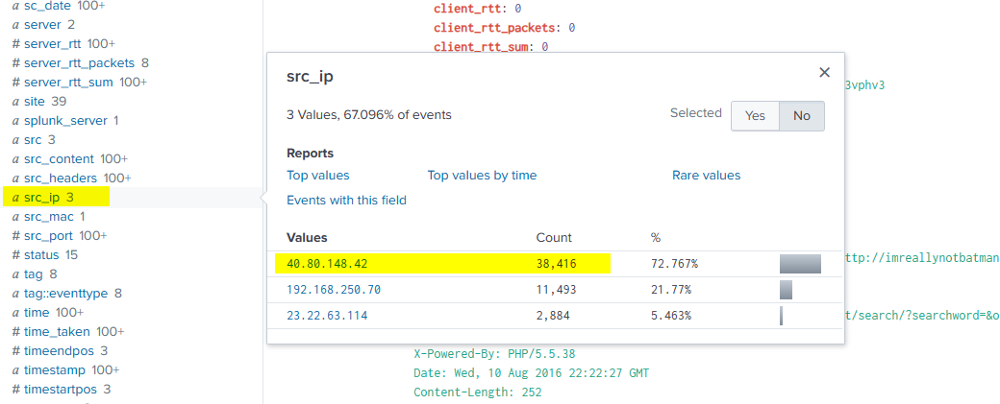

<figcaption>Şekil 2: Hedefe yönelik en yoğun harici trafiği üreten kaynak IP adresi (40.80.148.42).</figcaption>
</figure>

### 1.2 Web Zafiyet Tarayıcısı Parmak İzi (Fingerprinting)

Saldırganın otomatik bir güvenlik tarayıcısı kullanıp kullanmadığını anlamak için `40.80.148.42` adresine ait Suricata IDS alarm kayıtları incelenir:

<figure class="code-file">
<figcaption>Splunk SPL</figcaption>

```spl
index=botsv1 imreallynotbatman.com src_ip="40.80.148.42" sourcetype="suricata"
| table alert.signature
```

</figure>

Suricata imza kayıtları, saldırganın hedef web uygulamasındaki açıkları haritalamak için **Acunetix** web güvenlik açığı tarayıcısını kullandığını gösterir.

<figure>

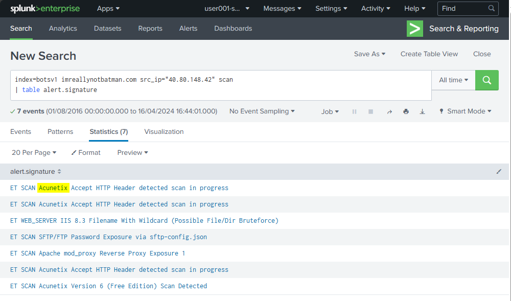

<figcaption>Şekil 3: Suricata imza kayıtlarında tespit edilen Acunetix tarayıcı alarmları.</figcaption>
</figure>

### 1.3 Hedef İçerik Yönetim Sisteminin (CMS) Belirlenmesi

Saldırganın hangi uygulama altyapısını hedef aldığını ortaya çıkarmak için taranan URI dizin yolları listelenir:

<figure class="code-file">
<figcaption>Splunk SPL</figcaption>

```spl
index=botsv1 imreallynotbatman.com src_ip="40.80.148.42"
| table url, uri, uri_path
```

</figure>

Dönen kayıtlarda `/joomla/` dizini altındaki bileşenlerin yoğun olarak tarandığı ve uygulamanın **Joomla CMS** kullandığı doğrulanır.

<figure>

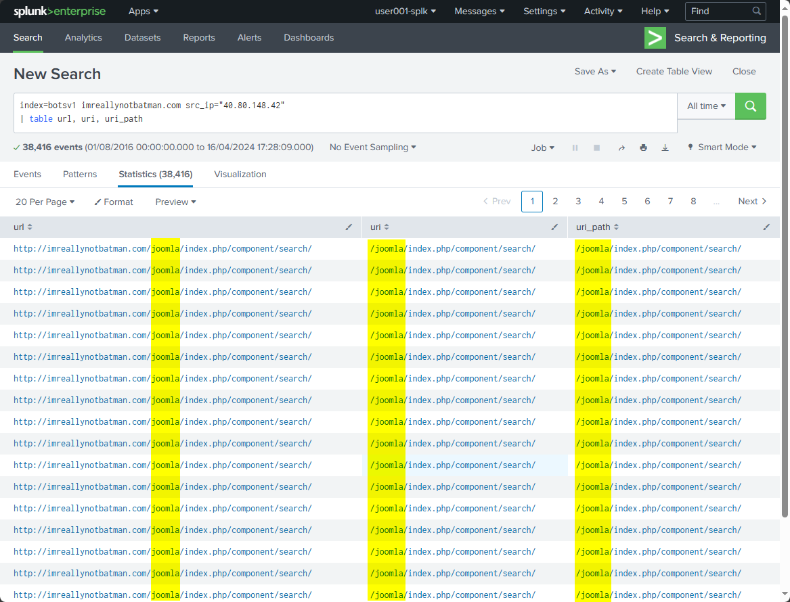

<figcaption>Şekil 4: Tarama loglarında ortaya çıkan Joomla CMS dizin yolları.</figcaption>
</figure>

## 2. Web Sunucusu Zafiyet Sömürüsü ve Kaba Kuvvet Saldırısı

Keşif aşamasının ardından saldırgan, Joomla yönetim paneline yetkisiz erişim sağlamak amacıyla kimlik doğrulama mekanizmasını hedef almıştır.

### 2.1 Hedef Web Sunucusunun Yerel IP Adresi

Harici tarama isteklerinin yönlendirildiği dahili hedef sunucuyu doğrulamak için `dest_ip` alanı filtrelenir:

<figure class="code-file">
<figcaption>Splunk SPL</figcaption>

```spl
index=botsv1 imreallynotbatman.com src_ip="40.80.148.42"
| stats count by dest_ip
```

</figure>

Hedef web sunucusunun kurumsal ağdaki dahili IP adresinin `192.168.250.70` olduğu saptanır.

<figure>

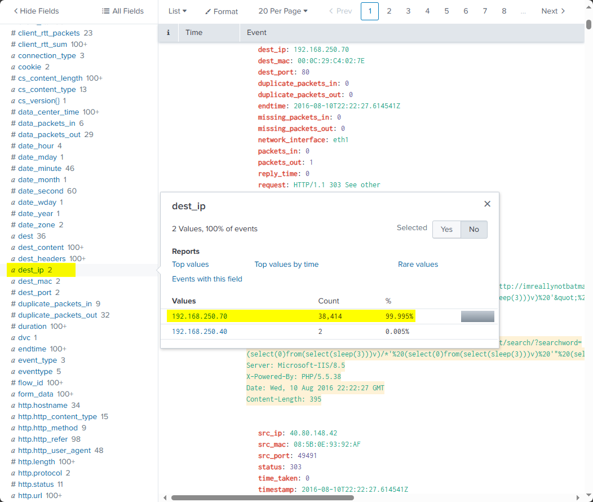

<figcaption>Şekil 5: Saldırganın hedef aldığı dahili web sunucusu IP adresi (192.168.250.70).</figcaption>
</figure>

### 2.2 Brute Force Saldırısı ve İkincil Altyapı Kullanımı

Saldırgan keşif aşamasından sonra kaba kuvvet (brute force) saldırısını farklı bir IP adresinden başlatmıştır. HTTP POST istekleri sorgulanarak parola denemelerinin kaynağı incelenir:

<figure class="code-file">
<figcaption>Splunk SPL</figcaption>

```spl
index="botsv1" dest_ip="192.168.250.70" http_method=POST uri_path="/joomla/administrator/index.php"
| stats count by src_ip, status
```

</figure>

Sorgu sonuçları, **`23.22.63.114`** IP adresinden sunucudaki Joomla yönetici oturum açma yoluna 27.000'in üzerinde HTTP POST isteği gönderildiğini ortaya koyar. Tehdit aktörü tarama aşamasında kullandığı IP adresini (`40.80.148.42`) kaba kuvvet saldırısında ikincil bir altyapı adresiyle (`23.22.63.114`) değiştirmiştir.

<figure>

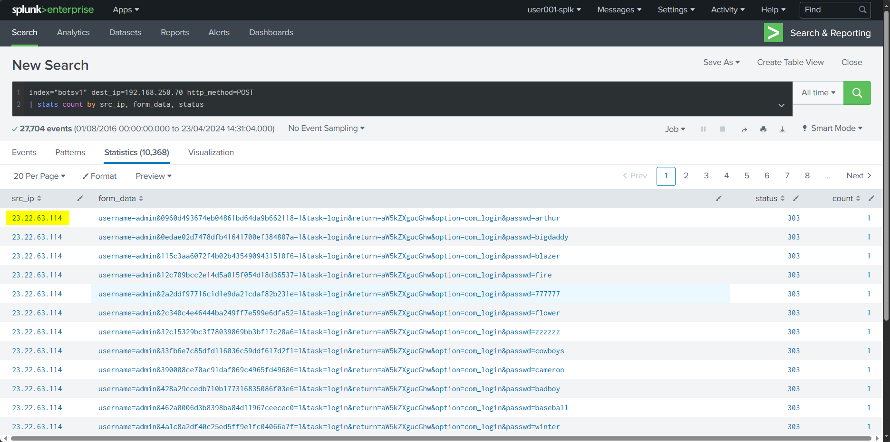

<figcaption>Şekil 6: 23.22.63.114 IP adresinden Joomla paneline yönelik yürütülen kaba kuvvet saldırısı.</figcaption>
</figure>

### 2.3 Doğru Parolanın Tespiti ve Kimlik Bilgisi Ele Geçirme

Saldırganın denediği parolaları ve oturum açma isteklerini ayrıştırmak için `stream:http` akışındaki `form_data` alanı regex (`rex`) ile parse edilir:

<figure class="code-file">
<figcaption>Splunk SPL</figcaption>

```spl
index=botsv1 sourcetype="stream:http" dest_ip="192.168.250.70" form_data=*username*passwd*
| rex field=form_data "passwd=(?<userpasswd>\w+)"
| stats count by src_ip, userpasswd
```

</figure>

Loglar incelendiğinde `23.22.63.114` adresinden 400'ün üzerinde farklı parola denenirken, ilk taramayı yürüten `40.80.148.42` IP adresinden yalnızca tek bir oturum açma isteği gönderildiği görülür. Bu istekte kullanılan parolanın **`batman`** olduğu ve yönetici paneline başarıyla erişildiği tespit edilir.

<figure>

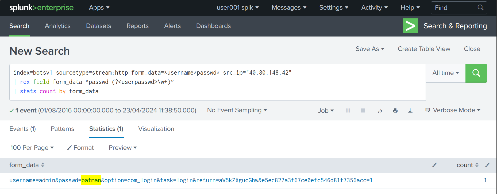

<figcaption>Şekil 7: 40.80.148.42 adresinden gönderilen ve geçerli yönetici parolası olan "batman".</figcaption>
</figure>

### 2.4 Saldırgan Reaksiyon Süresi (Reaction Time)

Brute force saldırısında doğru parolanın bulunması ile saldırganın orijinal IP adresinden yönetim paneline manuel olarak oturum açması arasında geçen süre `transaction` komutuyla ölçülür:

<figure class="code-file">
<figcaption>Splunk SPL</figcaption>

```spl
index=botsv1 sourcetype="stream:http" dest_ip="192.168.250.70" http_method=POST uri_path="/joomla/administrator/index.php"
| rex field=form_data "passwd=(?<password>\w+)"
| search password="batman"
| transaction password
| eval duration_seconds = round(duration, 2)
| table _time, password, duration_seconds
```

</figure>

İki olay arasındaki süre farkı **92.17 saniye** olarak ölçülmüştür. Bu süre değeri, saldırganın otomatik brute force aracının çıktısını kontrol ettikten sonra web tarayıcısına geçerek oturumu manuel açtığını doğrular.

<figure>

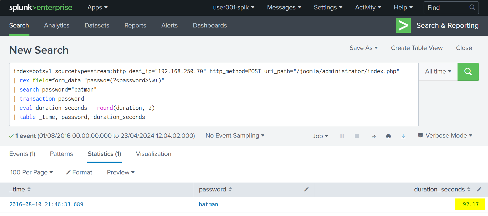

<figcaption>Şekil 8: Parolanın ele geçirilmesi ile interaktif oturum açma arasındaki reaksiyon süresi (92.17 saniye).</figcaption>
</figure>

## 3. Zararlı Dosya Yükleme ve Defacement

Yönetim paneline erişen tehdit aktörü, siteyi tahrif etmek ve hedef sistemde kalıcılık sağlamak amacıyla dosya indirme ve yükleme adımlarını yürütmüştür.

### 3.1 Defacement Görselinin İndirilmesi ve Dinamik DNS Altyapısı

Web sunucusunun (`192.168.250.70`) harici kaynaklardan istemci olarak hangi dosyaları çektiği `c_ip` alanı üzerinden sorgulanır:

<figure class="code-file">
<figcaption>Splunk SPL</figcaption>

```spl
index="botsv1" c_ip="192.168.250.70"
| stats count by url
```

</figure>

Web sunucusunun dış ağdan **`poisonivy-is-coming-for-you-batman.jpeg`** adlı defacement görselini indirdiği belirlenir. İndirmenin yapıldığı alan adı incelendiğinde saldırganın dinamik DNS sağlayıcısı üzerinden yapılandırdığı **`prankglassinebracket.jumpingcrab.com`** adresini kullandığı görülür.

<figure>

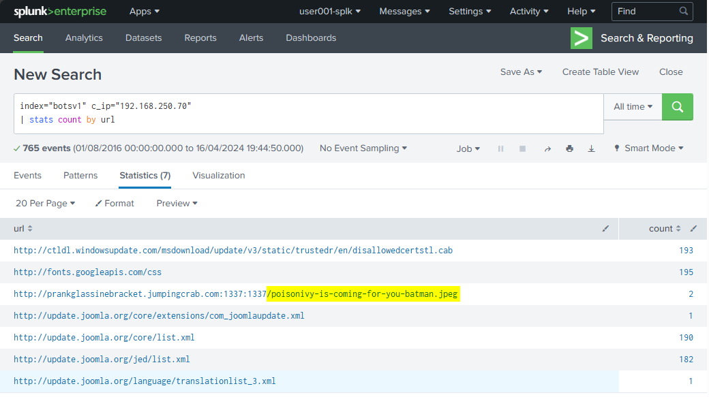

<figcaption>Şekil 9: Web sunucusu tarafından çekilen defacement görseli ve jumpingcrab.com dinamik DNS adresi.</figcaption>
</figure>

### 3.2 Zararlı Çalıştırılabilir Dosya (Executable Payload) Yüklemesi

Tehdit aktörünün sunucuya görsel dışında ikili bir dosya (binary) yükleyip yüklemediğini anlamak için HTTP POST yükleme akışları taranır:

<figure class="code-file">
<figcaption>Splunk SPL</figcaption>

```spl
index=botsv1 dest_ip="192.168.250.70" sourcetype="stream:http" http_method=POST *.exe
```

</figure>

Joomla eklenti / dosya yükleme mekanizması üzerinden sunucuya **`3791.exe`** isimli çalıştırılabilir bir dosyanın aktarıldığı saptanır.

<figure>

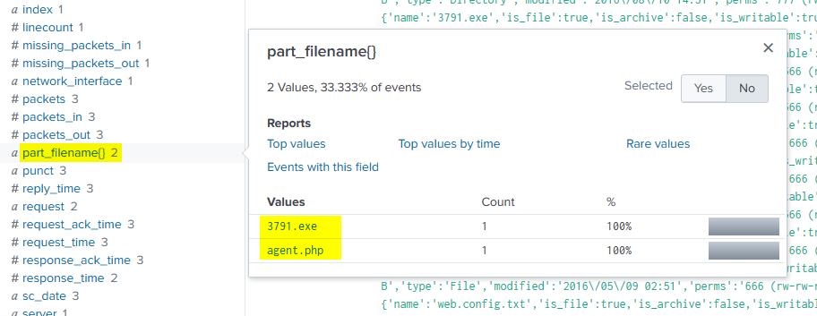

<figcaption>Şekil 10: HTTP POST akışında yakalanan 3791.exe dosya transferi.</figcaption>
</figure>

### 3.3 Uç Noktada Zararlının Çalıştırılması ve MD5 Tespiti

`3791.exe` dosyasının web sunucusunda bir işlem (process) olarak çalıştırılıp çalıştırılmadığını teyit etmek için Sysmon telemetrisi sorgulanır:

<figure class="code-file">
<figcaption>Splunk SPL</figcaption>

```spl
index="botsv1" sourcetype="XmlWinEventLog:Microsoft-Windows-Sysmon/Operational" CommandLine="*3791.exe"
| table _time, host, ParentImage, Image, CommandLine, Hashes
```

</figure>

Sysmon Event ID 1 (Process Creation) kaydı, `3791.exe` dosyasının sistem üzerinde çalıştırıldığını ve dosyanın MD5 hash değerinin **`AAE3F5A29935E6ABCC2C2754D12A9AF0`** olduğunu doğrular.

<figure>

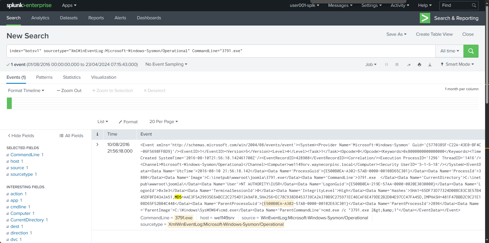

<figcaption>Şekil 11: Sysmon Event ID 1 üzerinde 3791.exe'nin çalıştırılması ve MD5 hash değeri.</figcaption>
</figure>

## 4. Tehdit İstihbaratı ve İlişkili Zararlı Analizi

Kaba kuvvet saldırısında kullanılan `23.22.63.114` IP adresi tehdit istihbaratı platformlarında (VirusTotal) sorgulanarak tehdit aktörünün diğer faaliyetleri haritalandırılmıştır.

<figure>

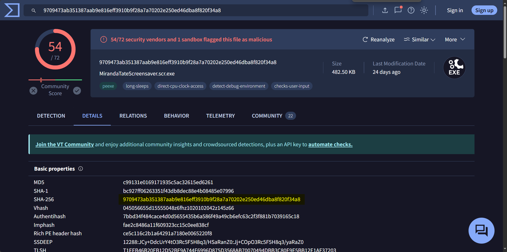

<figcaption>Şekil 12: 23.22.63.114 altyapısı ile ilişkili tespit edilen zararlı ekran koruyucu dosyası.</figcaption>
</figure>

İstihbarat korelasyonunda bu altyapıyla ilişkili olan ve Wayne Enterprises çalışanlarına yönelik oltalama faaliyetlerinde kullanılan `MirandaTateScreensaver.scr.exe` (SHA256: `9709473ab351387aab9e816eff3910b9f28a7a70202e250ed46dba8f820f34a8`) adlı zararlı yazılım tespit edilmiştir.

## MITRE ATT&CK

| Taktik | Teknik ID | Teknik Adı | Olaydaki Karşılığı |
| :--- | :--- | :--- | :--- |
| **Reconnaissance** | T1595.002 | Active Scanning: Vulnerability Scanning | `40.80.148.42` adresinden Acunetix ile Joomla CMS zafiyet taraması |
| **Initial Access** | T1110.001 | Brute Force: Password Guessing | `23.22.63.114` üzerinden Joomla yönetici paneline kaba kuvvet saldırısı |
| **Initial Access** | T1078.003 | Valid Accounts: Local Accounts | Ele geçirilen `admin:batman` bilgileriyle `40.80.148.42` üzerinden oturum açma |
| **Execution** | T1059.003 | Command and Scripting Interpreter: Windows Command Shell | Sunucuda `3791.exe` zararlısının çalıştırılması (Sysmon Event ID 1) |
| **Command and Control** | T1105 | Ingress Tool Transfer | Web sunucusunun `prankglassinebracket.jumpingcrab.com` üzerinden görsel çekmesi |
| **Command and Control** | T1568.002 | Dynamic Resolution: Dynamic DNS | Altyapı barındırma için jumpingcrab.com dinamik DNS servisinin kullanılması |
| **Impact** | T1491.001 | Defacement: Internal Defacement | `poisonivy-is-coming-for-you-batman.jpeg` ile ana sayfanın tahrif edilmesi |
| **Resource Development** | T1584 | Compromise Infrastructure | `23.22.63.114` IP adresinin saldırı hazırlığı (pre-staging) için konumlandırılması |

## IOCs

| Artifact | Tür | Değer | Açıklama |
| :--- | :--- | :--- | :--- |
| `40.80.148.42` | IPv4 | `40.80.148.42` | Acunetix taraması ve yetkisiz oturum açma kaynağı |
| `23.22.63.114` | IPv4 | `23.22.63.114` | Joomla kaba kuvvet saldırısı kaynağı ve saldırgan altyapısı |
| `192.168.250.70` | IPv4 (Dahili) | `192.168.250.70` | Hedef Joomla web sunucusu |
| `prankglassinebracket.jumpingcrab.com` | FQDN | `prankglassinebracket.jumpingcrab.com` | Defacement görselinin barındırıldığı dinamik DNS adresi |
| `poisonivy-is-coming-for-you-batman.jpeg` | Dosya Adı | `poisonivy-is-coming-for-you-batman.jpeg` | Web sitesini tahrif etmek için kullanılan görsel |
| `3791.exe` | Dosya Adı | `3791.exe` | Web sunucusuna yüklenen zararlı çalıştırılabilir dosya |
| `AAE3F5A29935E6ABCC2C2754D12A9AF0` | Hash (MD5) | `AAE3F5A29935E6ABCC2C2754D12A9AF0` | `3791.exe` dosyasının MD5 hash değeri |
| `MirandaTateScreensaver.scr.exe` | Dosya Adı | `MirandaTateScreensaver.scr.exe` | Saldırgan altyapısıyla ilişkili oltalama zararlısı |
| `9709473ab351387aab9e816eff3910b9f28a7a70202e250ed46dba8f820f34a8` | Hash (SHA256) | `9709473ab351387aab9e816eff3910b9f28a7a70202e250ed46dba8f820f34a8` | `MirandaTateScreensaver.scr.exe` SHA256 hash değeri |
