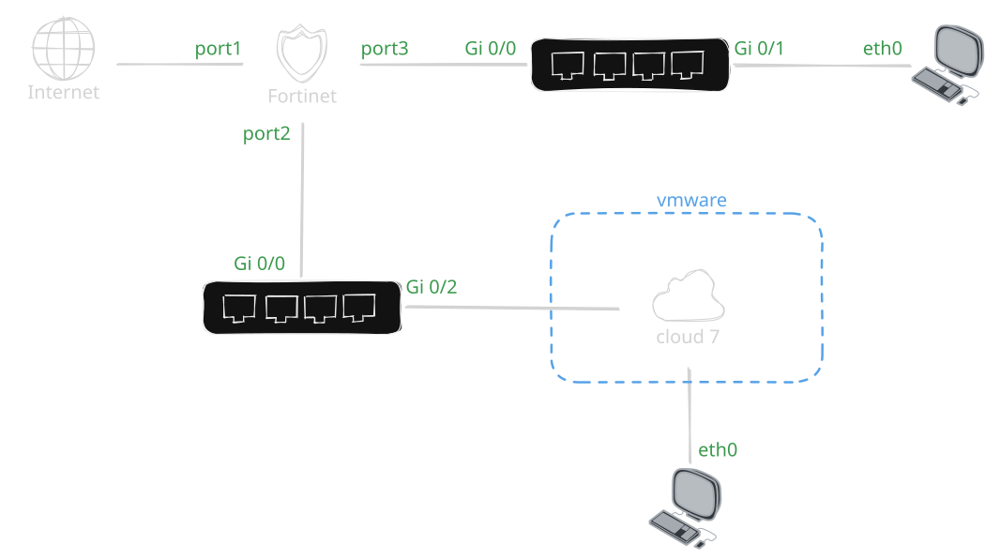
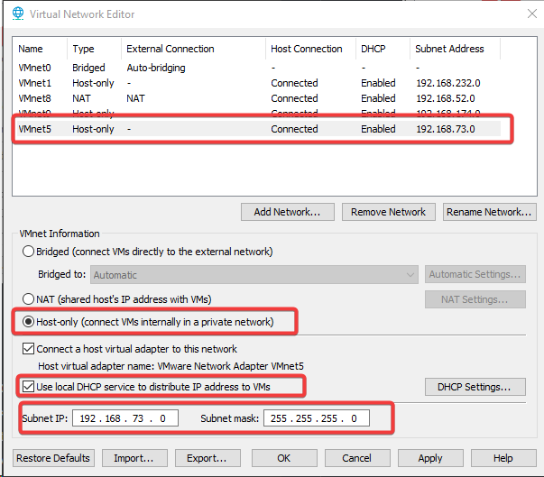
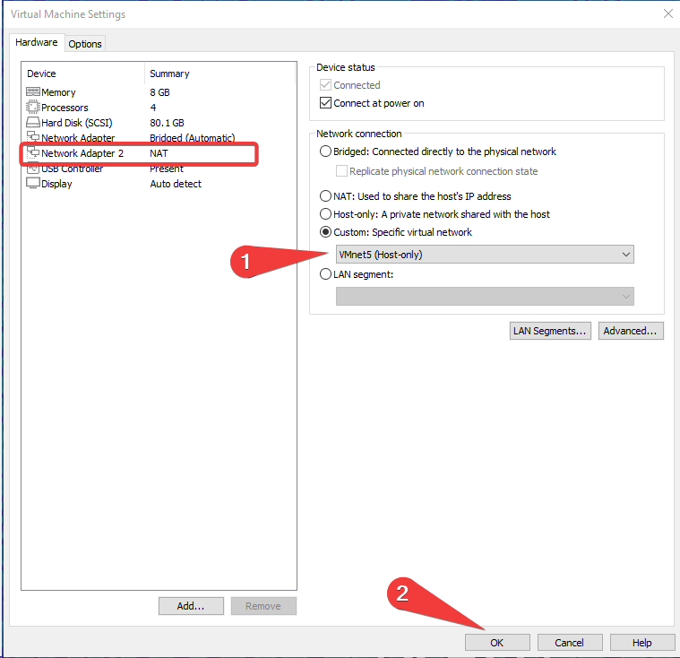
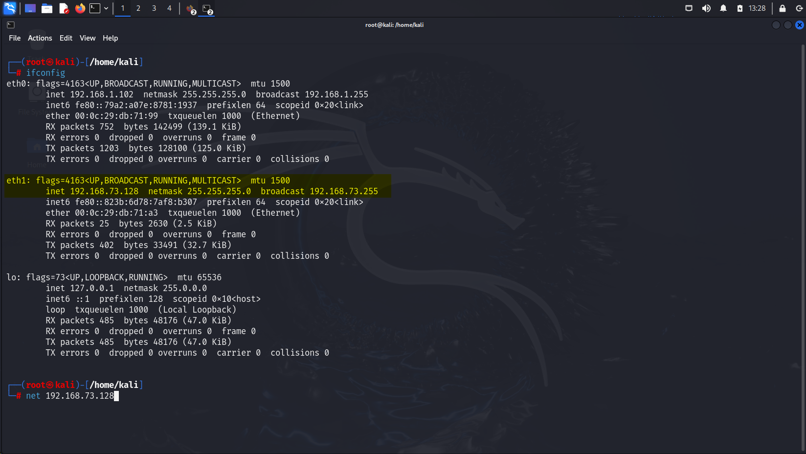
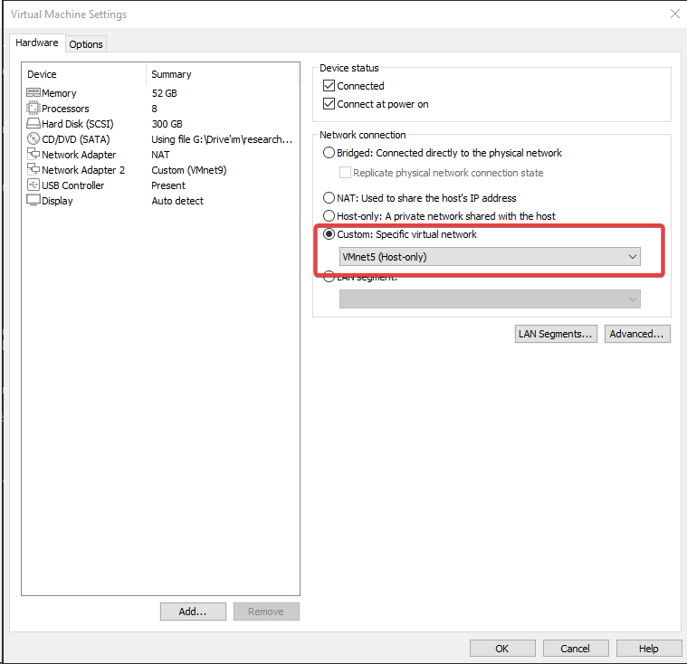
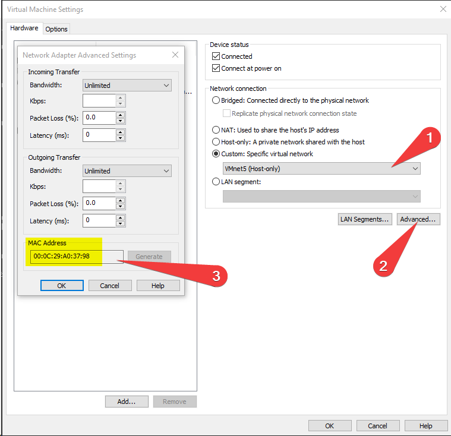
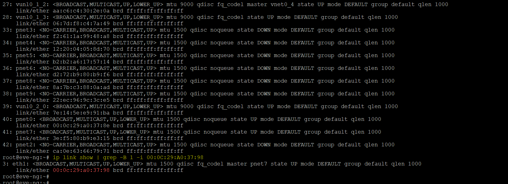
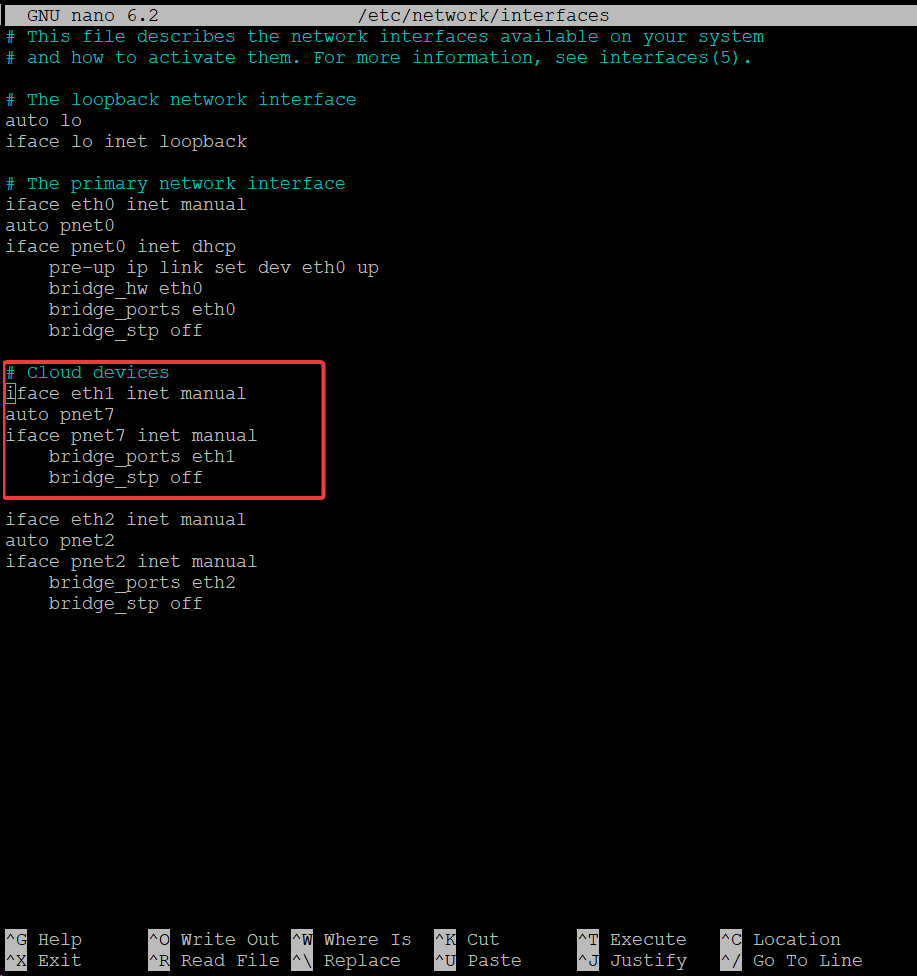
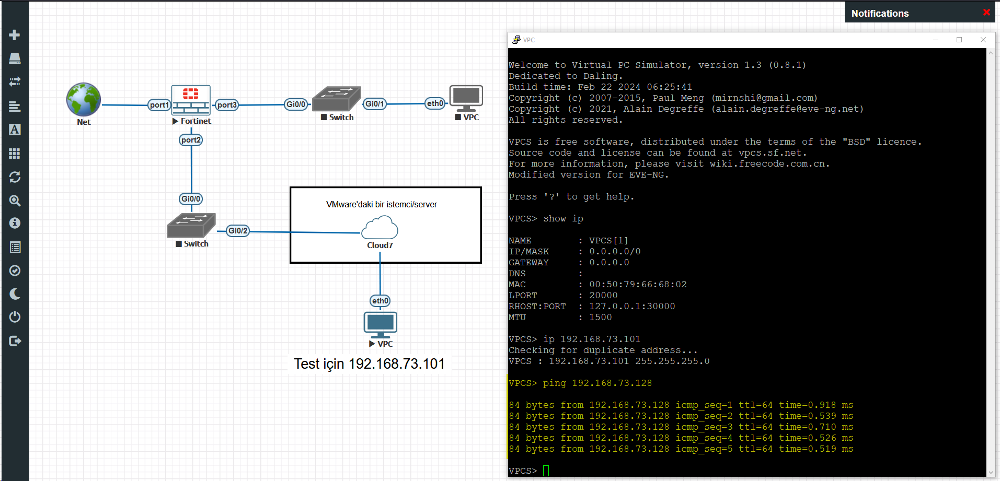
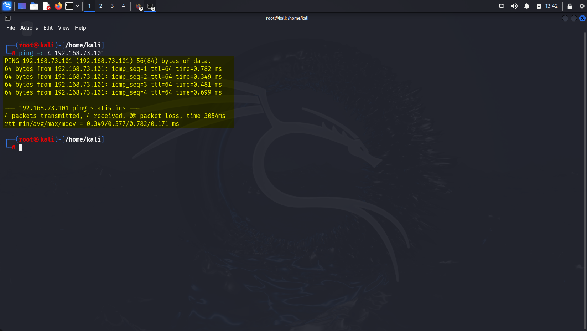

EVE-NG sanal lab ortamındaki cihazlar ile VMware Workstation üzerindeki bağımsız bir sanal makineyi (örneğin Kali Linux veya bir saldırı/yönetim sunucusu) doğrudan haberleştirmek için VMware'ın izole sanal ağlarından faydalanılır.

Bu çalışmada, VMware Workstation üzerinde özel bir Host-only ağı (`VMnet5`) oluşturularak EVE-NG içerisindeki `Cloud7` arayüzü ile köprülenecek (`bridge`); böylece VMware sanal makinesi ile EVE-NG içerisindeki FortiGate ve VPC düğümleri aynı Katman 2/3 yayın etki alanına (broadcast domain) dahil edilecektir.

<figure>



<figcaption>Şekil 1: EVE-NG Cloud7 ve VMware VMnet5 entegrasyon lab topolojisi.</figcaption>
</figure>

## 1. VMware Üzerinde VMnet5 Host-Only Ağının Oluşturulması

İlk adımda VMware Workstation **Virtual Network Editor** aracı açılarak yalnızca ana makine ve sanal makineler arasında izole kalacak bir `VMnet5` ağı tanımlanır:

- **Ağ Türü:** Host-only (İnternet çıkışı kapalı, yerel izole ağ)
- **Alt Ağ IP:** `192.168.73.0/24`
- **DHCP:** Etkin (Sanal makinelere otomatik IP dağıtımı için)

<figure>



<figcaption>Şekil 2: Virtual Network Editor üzerinde 192.168.73.0/24 alt ağıyla yapılandırılan VMnet5.</figcaption>
</figure>

## 2. İstemci Sanal Makinesine VMnet5 Adaptörü Eklenmesi

Lab ortamına bağlanacak olan istemci sanal makinesine (bu senaryoda Kali Linux) ikinci bir ağ adaptörü eklenir ve **Custom: Specific virtual network** seçeneğinden `VMnet5 (Host-only)` atanır.

<figure>



<figcaption>Şekil 3: Kali Linux sanal makinesine ikinci ağ arayüzü olarak VMnet5 atanması.</figcaption>
</figure>

İstemci işletim sistemi başlatıldığında arayüzün DHCP üzerinden yapılandırıldığı doğrulanır:

<figure class="code-file">
<figcaption>Bash</figcaption>

```bash
ifconfig eth1
```

</figure>

Arayüzün VMnet5 DHCP havuzundan `192.168.73.128` IP adresini aldığı görülür.

<figure>



<figcaption>Şekil 4: Kali Linux üzerinde eth1 arayüzünün 192.168.73.128 IP adresini alması.</figcaption>
</figure>

## 3. EVE-NG Sanal Makinesine VMnet5 Adaptörünün Tanımlanması

Aynı ağ bağlantısını EVE-NG sunucusuna kazandırmak için EVE-NG sanal makinesinin ayarlarına da `VMnet5` ağında çalışan yeni bir ağ adaptörü eklenir.

<figure>



<figcaption>Şekil 5: EVE-NG sanal makinesi donanım ayarlarına eklenen VMnet5 adaptörü.</figcaption>
</figure>

Eklenen adaptörün VMware tarafından atanan MAC adresi (örneğin `00:0C:29:A0:37:98`) gelişmiş ayarlardan kontrol edilir. Bu MAC adresi, Linux kabuğunda arayüz eşleştirmesi yaparken gerekecektir.

<figure>



<figcaption>Şekil 6: VMnet5 adaptörüne atanan donanım (MAC) adresi.</figcaption>
</figure>

## 4. EVE-NG İçerisinde Ağ Köprüsünün (Bridge) Yapılandırılması

EVE-NG sunucusuna SSH veya konsol ile erişilir. Not alınan MAC adresi filtrelenerek yeni eklenen arayüzün işletim sistemindeki adı tespit edilir:

<figure class="code-file">
<figcaption>Bash</figcaption>

```bash
ip link show | grep -B 1 -i 00:0C:29:A0:37:98
```

</figure>

Çıktıda `00:0c:29:a0:37:98` MAC adresine sahip arayüzün `eth1` olduğu saptanır.

<figure>



<figcaption>Şekil 7: MAC adresi sorgusu ile VMnet5'e karşılık gelen eth1 arayüzünün tespiti.</figcaption>
</figure>

EVE-NG'de harici ağları lab içine aktaran `Cloud` arayüzleri, arkaplanda Linux bridge (`pnet`) aygıtlarına karşılık gelir. Örneğin `Cloud7` arayüzü `pnet7` köprüsünü kullanır. 

Yeni arayüzü (`eth1`) `pnet7` ile eşleştirmek için `/etc/network/interfaces` dosyası düzenlenir:

<figure class="code-file">
<figcaption>/etc/network/interfaces</figcaption>

```text
iface eth1 inet manual

auto pnet7
iface pnet7 inet manual
    bridge_ports eth1
    bridge_stp off
```

</figure>

<figure>



<figcaption>Şekil 8: eth1 arayüzünün pnet7 köprüsüne bağlanması.</figcaption>
</figure>

Yapılandırmanın geçerli olması için ağ servisi yeniden başlatılır:

<figure class="code-file">
<figcaption>Bash</figcaption>

```bash
service networking restart
```

</figure>

Bu adımla birlikte veri yolu aşağıdaki mantıksal düzende tamamlanmış olur:

```text
Kali Linux (VMnet5) <---> eth1 (VMware Arayüzü) <---> pnet7 (Linux Bridge) <---> Cloud7 (EVE-NG Düğümü)
```

## 5. Lab İçi Bağlantı ve Test

EVE-NG web arayüzünde lab topolojisi açılır. Topolojiye bir `Cloud` düğümü eklenerek türü `Cloud7` olarak belirlenir ve FortiGate cihazının `port2` arayüzüne bağlanır. Lab içerisindeki test VPC düğümüne statik olarak `192.168.73.101` IP adresi tanımlanır.

VPC üzerinden VMware tarafındaki Kali Linux istemcisine (`192.168.73.128`) ping testi gönderilir:

<figure>



<figcaption>Şekil 9: EVE-NG VPC düğümünden VMware Kali istemcisine gerçekleştirilen başarılı ping testi.</figcaption>
</figure>

Aynı şekilde Kali Linux üzerinden FortiGate ve VPC hedef alınarak çift yönlü erişim doğrulanır:

<figure class="code-file">
<figcaption>Bash</figcaption>

```bash
ping -c 4 192.168.73.101
```

</figure>

Paket kaybı olmadan tüm paketlerin ulaştığı doğrulanır.

<figure>



<figcaption>Şekil 10: Kali Linux üzerinden 0% paket kaybıyla lab içi düğümlere erişim kanıtı.</figcaption>
</figure>

Bu mimari sayesinde VMware üzerinde çalışan sızma testi araçları, güvenlik tarayıcıları ve analiz yazılımları, EVE-NG içindeki karmaşık topolojilere sanki aynı fiziksel anahtara (switch) bağlıymış gibi doğrudan erişebilir.
