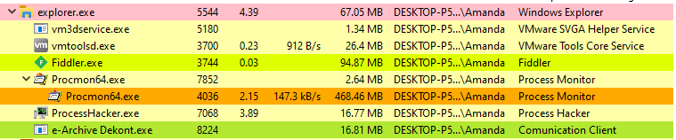
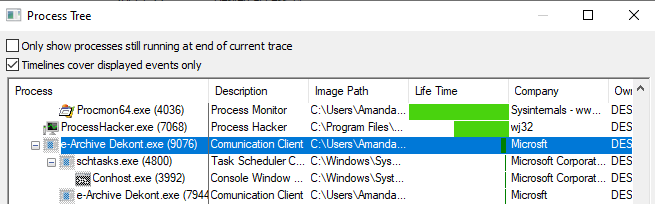
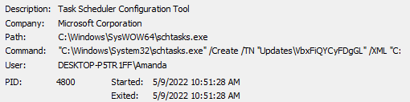
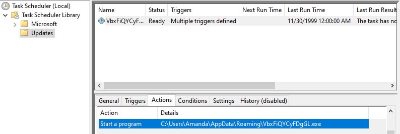
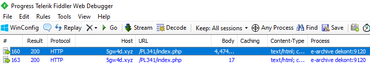
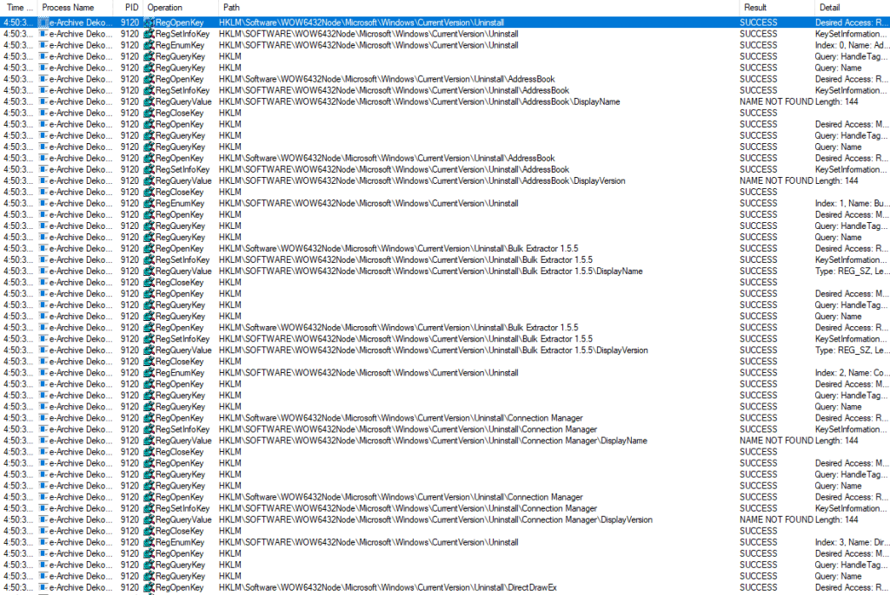
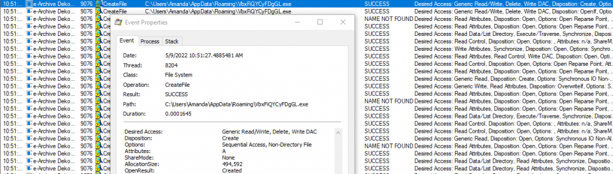
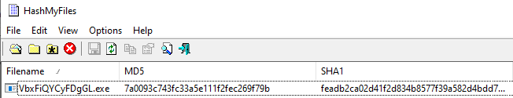
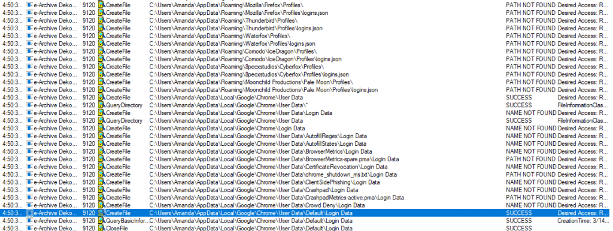

Bu çalışmada, e-posta oltalama (phishing) senaryolarında dekont/fatura süsü verilerek iletilen şüpheli bir yürütülebilir dosyanın (`e-archive dekont.exe`) yalıtılmış analiz ortamında dinamik davranışlarını inceliyoruz. Analiz sürecinde Process Hacker, Sysinternals Procmon, Regshot ve Fiddler kullanılarak sürecin oluşturduğu child process'ler, persistence mekanizmaları, ağ trafiği ve kimlik bilgisi hırsızlığı aktiviteleri adım adım belgelenmiştir.

<figure class="code-file">
<figcaption>Dosya Bilgileri (Sample Metadata)</figcaption>

```text
Dosya Adı : e-archive dekont.exe
MD5        : 7a0093c743fc33a5e111f2fec269f79b
SHA256     : 722ef401e5cbb067c5c33faa402774d3c75ef08e0c8cc4d7e66a9cfa53684088
Format     : Windows PE32 executable (Trojan / Infostealer)
```

</figure>

## 1. Analiz Ortamı ve İzleme

Zararlı yazılım çalıştırılmadan önce sistemin temel durumu kaydedildi ve davranışları yakalamak üzere şu araç seti yapılandırıldı:

- **Process Hacker:** Anlık süreç durumları ve bellek dökümü takibi.
- **Sysinternals Procmon:** Süreç hiyerarşisi, dosya sistemi ve registry operasyonlarının geriye dönük telemetrisi.
- **Regshot:** Zararlı çalıştırma öncesi ve sonrası kayıt defteri durum karşılaştırması (baseline delta).
- **Fiddler:** HTTP/HTTPS komuta kontrol (C2) oturumlarının tespiti.

## 2. İlk Çalıştırma Zinciri ve Process Ağacı

Zararlı dosya çalıştırıldığında Process Hacker arayüzünde ilk bakışta yalnızca tek bir sürecin aktif olduğu görülür:

<figure>



<figcaption>Şekil 1: Process Hacker arayüzünde görülen anlık süreç.</figcaption>
</figure>

Process Hacker yalnızca o anda canlı olan süreçleri listeler; kısa süreliğine çalışıp sonlanan child process'leri kaçırabilir. Bu kör noktayı gidermek için Sysinternals Procmon'un geriye dönük **Show Process Tree** özelliği açıldığında tam çalıştırma zinciri ortaya çıkar:

<figure>



<figcaption>Şekil 2: Procmon Process Tree üzerinde tespit edilen tam çalıştırma zinciri.</figcaption>
</figure>

Süreç hiyerarşisi şu sırayla gerçekleşmiştir:

1. `e-archive dekont.exe` (PID 9076) çalıştırıldı.
2. Bu süreç, Windows Görev Zamanlayıcısı komut satırı aracı olan `schtasks.exe` (PID 4800) sürecini tetikledi.
3. Ardından `%APPDATA%` altına bırakılan `vbxfiqycyfdggl.exe` (PID 7944) adlı yeni bir binary çalıştırıldı.

## 3. Scheduled Task ile Kalıcılık (Persistence - T1053.005)

Saldırganın sisteme bıraktığı zamanlanmış görevin ayrıntılarını görmek için Procmon üzerinde `schtasks.exe` olayının komut satırı argümanları incelendi:

<figure>



<figcaption>Şekil 3: schtasks.exe sürecinin çalıştırdığı komut satırı ve geçici XML yapılandırma yolu.</figcaption>
</figure>

Komut satırında `updates\vbxfiqycyfdggl` isimli bir görevin sisteme eklendiği tespit edildi. Windows Task Scheduler konsolundan görevin detayları doğrulandı:

<figure>



<figcaption>Şekil 4: Oturum açıldığında çalıştırılacak dosya yolu ve tetikleyici ayarları.</figcaption>
</figure>

Görevin tetikleyicisi kullanıcı oturum açılışı (`At log on`), çalıştırılacak eylem ise `C:\Users\Amanda\AppData\Roaming\vbxfiqycyfdggl.exe` olarak yapılandırılmıştır. Böylece zararlı yazılım sistem yeniden başlatılsa bile kalıcılık (persistence) sağlamaktadır.

## 4. Komuta Kontrol (C2) Trafiği (T1071.001)

Fiddler oturum kayıtları incelendiğinde, zararlı yazılımın harici bir sunucuyla HTTP üzerinden iletişime geçtiği görüldü:

<figure>



<figcaption>Şekil 5: 5gw4d[.]xyz alan adına yapılan HTTP POST/GET istekleri.</figcaption>
</figure>

Zararlı yazılım, komuta kontrol sunucusu olarak `5gw4d[.]xyz` adresini kullanmakta ve `http://5gw4d[.]xyz/pl341/index.php` uç noktasına HTTP üzerinden veri aktarmaktadır.

## 5. Keşif ve Savunma Atlatma (Discovery & Defense Evasion)

Zararlı yazılımın sistem üzerindeki keşif faaliyetleri incelendiğinde, ortamdaki güvenlik yazılımlarını ve kurulu programları denetlediği saptandı:

<figure>



<figcaption>Şekil 6: Wow6432Node Uninstall anahtarının yinelemeli taranması.</figcaption>
</figure>

Saldırgan süreç, `HKLM\Software\Wow6432Node\Microsoft\Windows\CurrentVersion\Uninstall` anahtarını yinelemeli olarak sorgulamıştır (MITRE ATT&CK T1518 Software Discovery). Bu davranış, sistemde antivirüs veya analiz araçlarının bulunup bulunmadığını anlamak için yaygın olarak kullanılır.

## 6. Dosya Sistemi Hareketleri ve Zararlı Dosya Bırakma (Payload Dropping)

Procmon üzerinde `Operation = CreateFile` filtresi uygulanarak dosya oluşturma hareketleri incelendi:

<figure>



<figcaption>Şekil 7: vbxfiqycyfdggl.exe dosyasının AppData\Roaming dizinine yazılması.</figcaption>
</figure>

Zararlı yazılım kendisini `C:\Users\Amanda\AppData\Roaming\vbxfiqycyfdggl.exe` yoluna kopyalamıştır. HashMyFiles aracıyla yapılan hash kontrolü, bu dosyanın ilk çalıştırılan `e-archive dekont.exe` ile birebir aynı SHA256 hash değerine sahip olduğunu doğrulamıştır:

<figure>



<figcaption>Şekil 8: Orijinal dosya ile bırakılan kopyanın hash eşleşmesi.</figcaption>
</figure>

## 7. Kimlik Bilgisi ve Veri Hırsızlığı (Credential Access)

Dosya erişim telemetrisi incelendiğinde, zararlının bilgi hırsızı (infostealer) niteliği kesinleşti:

<figure>



<figcaption>Şekil 9: Firefox, Chrome ve Thunderbird profil dizinlerinden veri toplama denemeleri.</figcaption>
</figure>

Zararlı süreç; Google Chrome, Mozilla Firefox (`logins.json`) ve Mozilla Thunderbird uygulamalarının yerel profil dizinlerindeki parola veritabanlarına, oturum çerezlerine ve e-posta arşivlerine erişmeye çalışmıştır (MITRE ATT&CK T1555 & T1539).

## IOCs

| Artifact | Tür | Değer | Açıklama |
| :--- | :--- | :--- | :--- |
| `e-archive dekont.exe` | SHA256 | `722ef401e5cbb067c5c33faa402774d3c75ef08e0c8cc4d7e66a9cfa53684088` | İlk çalıştırılan phishing payload |
| `e-archive dekont.exe` | MD5 | `7a0093c743fc33a5e111f2fec269f79b` | Orijinal dosya MD5 |
| `vbxfiqycyfdggl.exe` | Dosya Yolu | `C:\Users\%USERNAME%\AppData\Roaming\vbxfiqycyfdggl.exe` | Persistence için bırakılan kopya |
| `updates\vbxfiqycyfdggl` | Scheduled Task | Task Scheduler | Oturum açılışında (`ONLOGON`) tetiklenen persistence |
| `5gw4d[.]xyz` | Domain | C2 Server | Harici komuta kontrol sunucusu |
| `http://5gw4d[.]xyz/pl341/index.php` | URL | C2 Endpoint | HTTP veri sızdırma uç noktası |

## MITRE ATT&CK

| Taktik | Teknik ID | Teknik Adı | Gözlemlenen Davranış |
| :--- | :--- | :--- | :--- |
| Initial Access | `T1566.001` | Spearphishing Attachment | Sahte dekont adlı çalıştırılabilir dosya |
| Execution | `T1204.002` | Malicious File | Kullanıcı tarafından dosyanın çalıştırılması |
| Persistence | `T1053.005` | Scheduled Task | `schtasks.exe` ile oturum açılışına görev ekleme |
| Defense Evasion | `T1036.005` | Match Legitimate Name/Path | Kendini `%APPDATA%` altına kopyalama |
| Discovery | `T1518` | Software Discovery | Registry'de `Uninstall` anahtarlarını tarama |
| Credential Access | `T1555.003` | Credentials from Web Browsers | Chrome ve Firefox profil veritabanlarını okuma |
| Command & Control | `T1071.001` | Web Protocols | `5gw4d[.]xyz` adresine HTTP POST istekleri |
