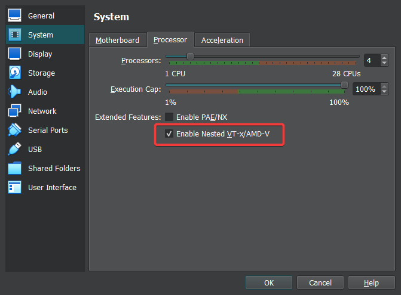
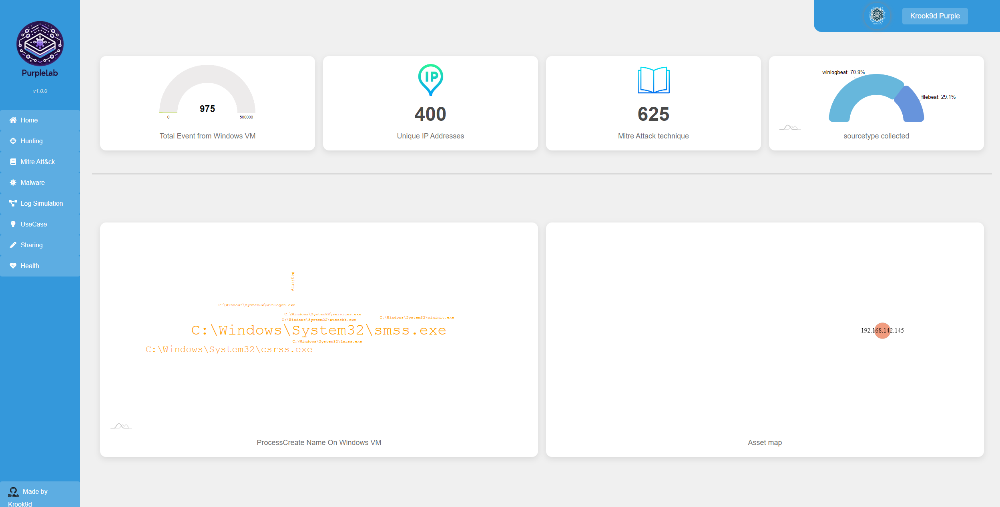
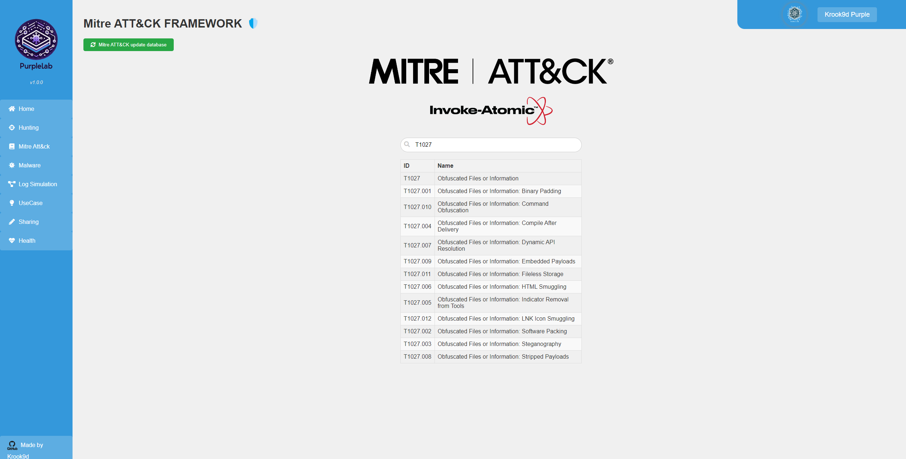
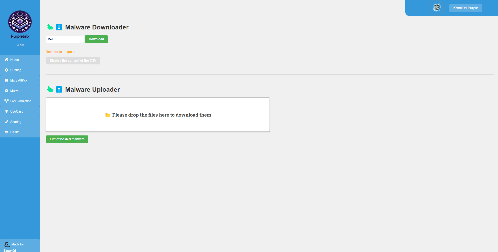
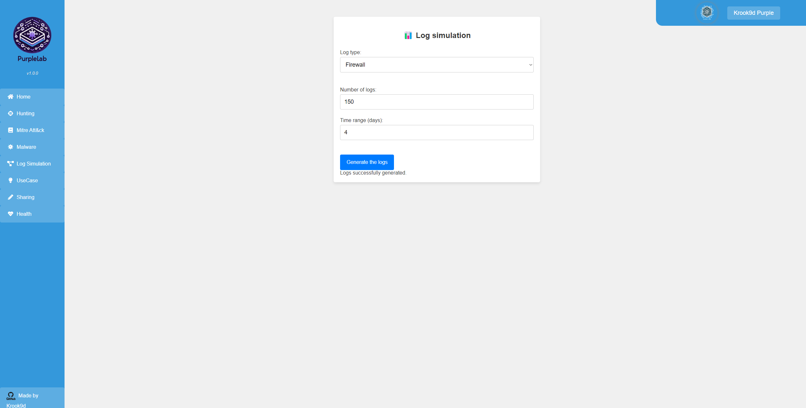
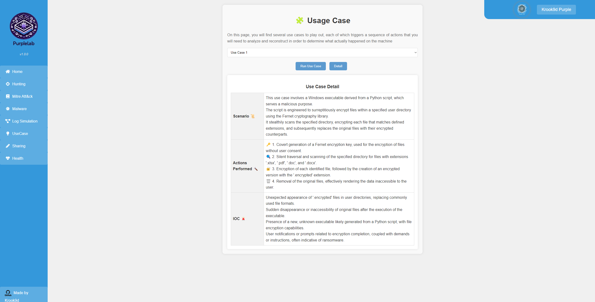
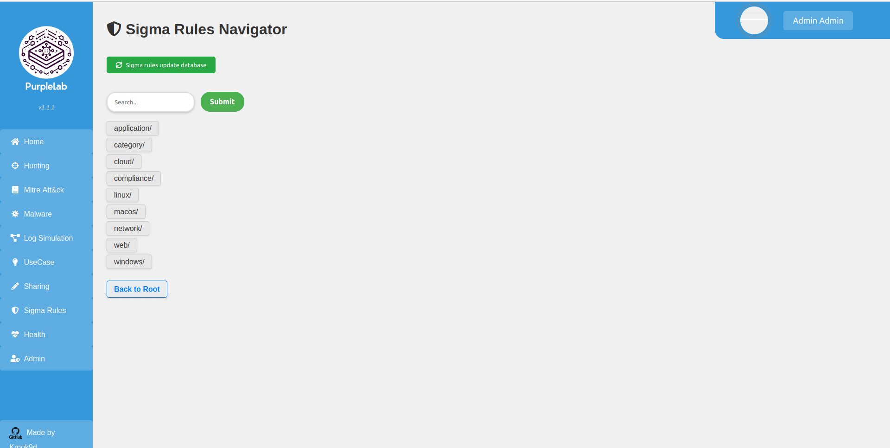
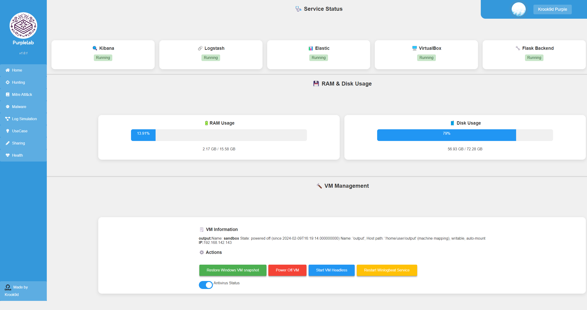

PurpleLab ([GitHub](https://github.com/Krook9d/PurpleLab)), algılama kurallarını test etmek, Atomic Red Team ile saldırı simülasyonları yürütmek ve malware detonation süreçlerini izole bir ortamda incelemek için tasarlanmış web tabanlı bir purple teaming platformudur.

Platform mimarisi temel olarak şu bileşenlerden oluşur:

- Saldırı simülasyonu, malware yükleme ve kural yönetimini sağlayan web arayüzü ve Flask backend
- Telemetri üreten ve adli analiz araçları (Forensictools) kurulu Windows 10 sandbox VM (VirtualBox)
- Log toplama ve analiz için Elasticsearch ve Kibana (ELK) altyapısı

<blockquote class="callout callout-warning">

Ortam varsayılan kimlik bilgileriyle çalışır ve hardening yapılmamıştır. Laboratuvarı mutlaka izole bir sanal ağda (Host-Only / Internal) barındırın.

</blockquote>

## Sistem Gereksinimleri

Platformu barındıracak ana sunucu (Ubuntu Server 22.04 LTS) için önerilen minimum kaynaklar:

- 200 GB disk alanı
- 8 vCPU
- 13 GB RAM

Ubuntu VM üzerinde VirtualBox ile Windows sandbox çalıştırılacağı için hipervizörde Nested Virtualization (VT-x/AMD-V) etkinleştirilmelidir.

<figure>



<figcaption>Şekil 1: VirtualBox VM ayarlarında Nested Virtualization etkinleştirmesi.</figcaption>
</figure>

VMware Workstation kullanıyorsanız: VM Ayarları -> İşlemciler -> Sanallaştırma Motoru sekmesinden "Virtualize Intel VT-x/EPT or AMD-V/RVI" seçeneğini aktif edin.

## Kurulum

Depoyu klonlayıp kurulum betiğini çalıştırın:

<figure class="code-file">
<figcaption>Bash</figcaption>

```bash
git clone https://github.com/Krook9d/PurpleLab.git
cd PurpleLab
sudo bash install.sh
```

</figure>

Kurulum sırasında varsayılan ELK SIEM'in kurulup kurulmayacağı sorulur. Arayüzün hazır panolarla tam entegre çalışması için ELK kurulumunu onaylayarak devam edin. Kurulum tamamlandığında yönetici hesabı bilgileri ev dizinindeki `admin.txt` dosyasına yazılır.

### Analist Hesabı

<figure>


<figcaption>Şekil 2: PurpleLab web yönetim arayüzü analist giriş ekranı.</figcaption>
</figure>

Kurulumun ardından tarayıcıdan sunucu IP adresine gidip `Register` düğmesi üzerinden analist hesabınızı tanımlayın. Giriş sonrası ilk ekranda log akışı henüz başlamadığı için uyarılar görünebilir; sonraki adımda VM telemetrisini bağlayacağız.

### ELK Entegrasyonu

1. `admin.txt` dosyasındaki enrollment token'ı kopyalayın. Web arayüzünde "Hunting" sayfasına giderek ELK ekranında token'ı girin.
2. Doğrulama kodunu almak için sunucuda şu komutu çalıştırın:

<figure class="code-file">
<figcaption>Bash</figcaption>

```bash
sudo /usr/share/kibana/bin/kibana-verification-code
```

</figure>

Token süresi dolarsa yeniden oluşturabilirsiniz:

<figure class="code-file">
<figcaption>Bash</figcaption>

```bash
sudo /usr/share/elasticsearch/bin/elasticsearch-create-enrollment-token --scope kibana
```

</figure>

### Windows Sandbox ve Winlogbeat Yapılandırması

Sandbox VM'den SIEM'e telemetri akışını sağlamak için `winlogbeat.yml` yapılandırmasını tamamlayacağız.

1. VM'nin IP adresini Health sayfasından veya ana makinede CLI üzerinden öğrenin:

```bash
sudo VBoxManage guestproperty get sandbox "/VirtualBox/GuestInfo/Net/0/V4/IP"
```

2. VM içerisinde yönetici PowerShell oturumu açarak Winlogbeat dizinine gidin:

```powershell
cd 'C:\Program Files\winlogbeat'
```

3. `winlogbeat.yml` dosyasını düzenleyin:
   - `password:` alanına `admin.txt` içindeki Elastic şifresini yazın.
   - IP adresini ELK sunucunuzun adresiyle güncelleyin.
   - `ca_trusted_fingerprint` değerini PurpleLab sunucusunda şu komutla alıp ekleyin:

<figure class="code-file">
<figcaption>Bash</figcaption>

```bash
sudo openssl x509 -fingerprint -sha256 -in /etc/elasticsearch/certs/http_ca.crt | awk -F '=' '/Fingerprint/{print $2}' | tr -d ':'
```

</figure>

4. Yapılandırmayı doğrulayıp Kibana ingest pipeline'larını kurun:

<figure class="code-file">
<figcaption>PowerShell</figcaption>

```powershell
& "C:\Program Files\Winlogbeat\winlogbeat.exe" test config -c "C:\Program Files\Winlogbeat\winlogbeat.yml" -e
.\winlogbeat.exe setup -e
```

</figure>

`Loaded Ingest pipelines` çıktısını gördükten sonra VM'yi yeniden başlatın.

### Temiz Durum Snapshot'ı (Baseline)

Testler, malware detonation ve saldırı simülasyonları sonrasında sandbox ortamını saniyeler içinde temiz haline döndürebilmek için baseline snapshot'ını alın:

<figure class="code-file">
<figcaption>Bash</figcaption>

```bash
sudo VBoxManage snapshot "sandbox" take "Snapshot1" --description "baseline clean state"
```

</figure>

Kibana Discover sekmesinde Windows event loglarının aktığını doğruladıktan sonra ortam kullanıma hazırdır.

## Kullanım ve Modüller

Flask backend servisini başlatmak için:

<figure class="code-file">
<figcaption>Bash</figcaption>

```bash
sudo python3 /home/$(logname)/app.py
```

</figure>

Sandbox VM'nin çalıştığını kontrol edip gerekirse headless modda başlatabilirsiniz:

```bash
sudo VBoxManage showvminfo sandbox --machinereadable | grep "VMState=" | awk -F'"' '{print $2}'
sudo VBoxManage startvm sandbox --type headless
```

### Windows 10 Sandbox Ortamı

<figure>


<figcaption>Şekil 3: Sandbox VM üzerinde yüklü gelen Forensictools adli analiz araç seti.</figcaption>
</figure>

Windows 10 Sandbox VM üzerinde Atomic Red Team modülleri ve adli bilişim incelemelerinde kullanılan [Forensictools](https://github.com/cristianzsh/forensictools) araç seti hazır olarak gelir.

### Home Paneli

<figure>



<figcaption>Şekil 4: Elasticsearch üzerinden toplanan genel telemetri metrikleri.</figcaption>
</figure>

Elasticsearch üzerinden toplanan telemetrileri özetler: toplam Windows event log sayısı, gözlemlenen tekil IP adresleri, tetiklenen MITRE ATT&CK teknikleri ve log türlerinin dağılımı gerçek zamanlı izlenebilir.

### Hunting

Kibana Discover paneline doğrudan geçiş sağlar. Sandbox VM olayları ve simüle edilen trafik burada KQL sorgularıyla filtrelenebilir.

### MITRE ATT&CK Simülasyonu

<figure>



<figcaption>Şekil 5: MITRE ATT&CK matrisi ve Atomic Red Team simülasyon arayüzü.</figcaption>
</figure>

MITRE ATT&CK matrisindeki teknikleri listeler ve Invoke-Atomic altyapısı üzerinden ilişkili test payload'larını sandbox VM üzerinde yürütür. Arama kutusuna teknik ID'si (örneğin `T1070`) girilerek ilgili teknik seçilir ve simülasyon başlatılır.

### Malware Detonation

<figure>



<figcaption>Şekil 6: Zararlı örnek indirme ve analiz ortamına yükleme paneli.</figcaption>
</figure>

İki temel işlev sunar:

- **Malware Downloader**: Abuse.ch MalwareBazaar üzerinden etiket bazlı (örneğin `Trojan`) güncel zararlı örneklerini indirir ve VM'ye aktarır. CSV listesi üzerinden örnekler tek tıkla çalıştırılabilir.
- **Malware Uploader**: Analiz edilmek istenen özel çalıştırılabilir dosyaları, betikleri veya DLL'leri (`.exe`, `.dll`, `.bin`, `.py`, `.ps1`) doğrudan sandbox ortamına yükler.

### Log Simülasyonu

<figure>



<figcaption>Şekil 7: Tespit kurallarını test etmek için sentetik log enjeksiyon paneli.</figcaption>
</figure>

Tespit kurallarını meşru trafik gürültüsü içinde test etmek amacıyla sentetik loglar üretir. Güvenlik duvarı logları için rastgele IP adresleri, Accept/Deny aksiyonları ve zaman damgaları tanımlanarak SIEM'e aktarılır.

### Use Case Senaryoları

<figure>



<figcaption>Şekil 8: Uçtan uca tanımlanmış gerçek dünya saldırı senaryoları.</figcaption>
</figure>

Gerçek dünya ihlallerini taklit eden uçtan uca saldırı senaryolarını çalıştırır. Her senaryo, adım adım saldırı akışını, çalıştırılan komutları ve beklenen IOC'leri içerir.

### Sigma Kural Gezgini

<figure>



<figcaption>Şekil 9: Sigma kuralları ve Splunk/Elasticsearch sözdizim dönüştürücüsü.</figcaption>
</figure>

Teknik ID veya anahtar kelimeye göre Sigma kurallarını listeler. Seçilen kuralı tek tıkla Splunk SPL veya Elasticsearch Lucene sorgu sözdizimine dönüştürür.

### Sistem ve Sağlık Takibi

<figure>



<figcaption>Şekil 10: ELK servisleri ve sanal makine kaynak tüketim göstergeleri.</figcaption>
</figure>

ELK servisleri, VirtualBox durumu ve Flask backend kaynak tüketimini gösterir. Sandbox VM'nin durumu ve snapshot geri yükleme aksiyonları da bu panelden yönetilebilir.

### Splunk Entegrasyonu ve API

Splunk üzerinde analiz yapmak isteyenler için [PurpleLab Integration App for Splunk](https://github.com/Krook9d/TA-Purplelab-Splunk) eklentisi mevcuttur. Detaylı kurulum ve laboratuvar mimarisi için [PurpleLab dokümantasyonu](https://github.com/Krook9d/PurpleLab) incelenebilir.
