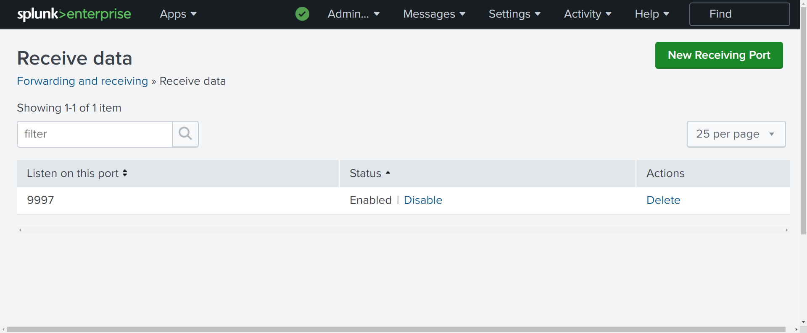
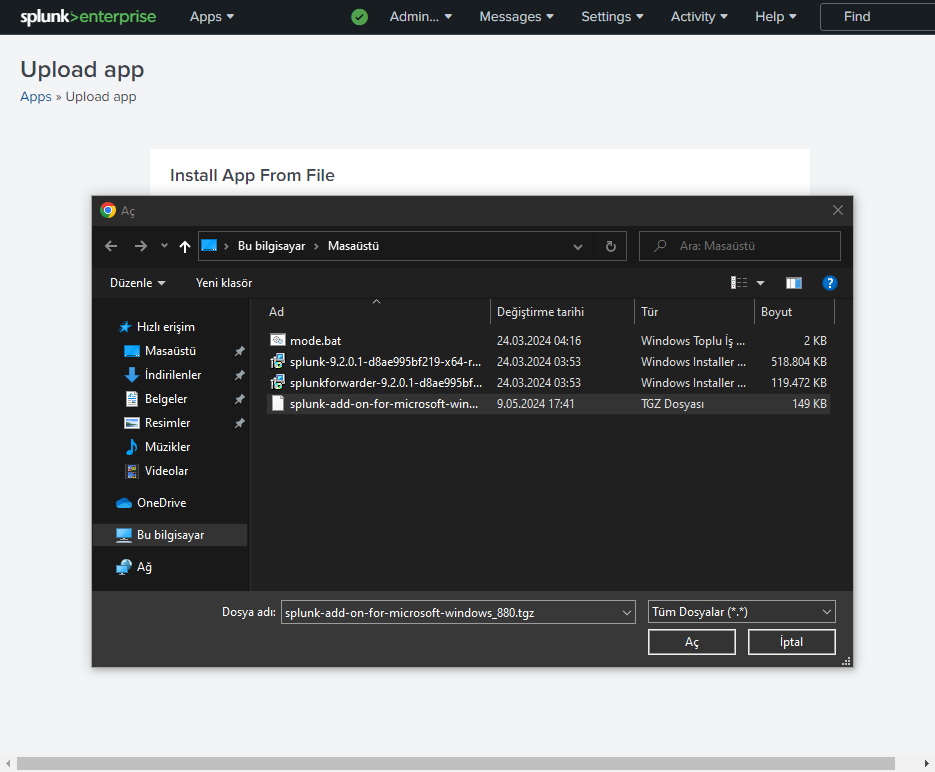
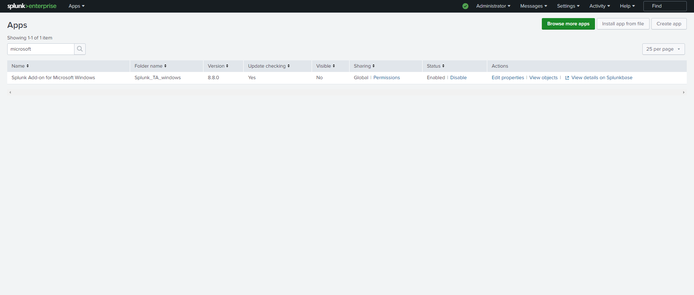
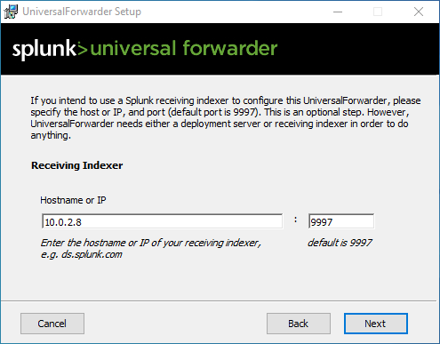
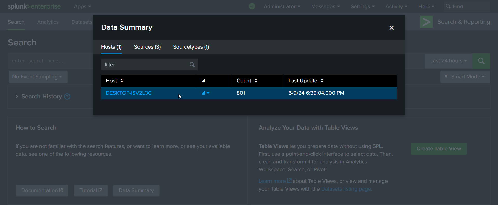
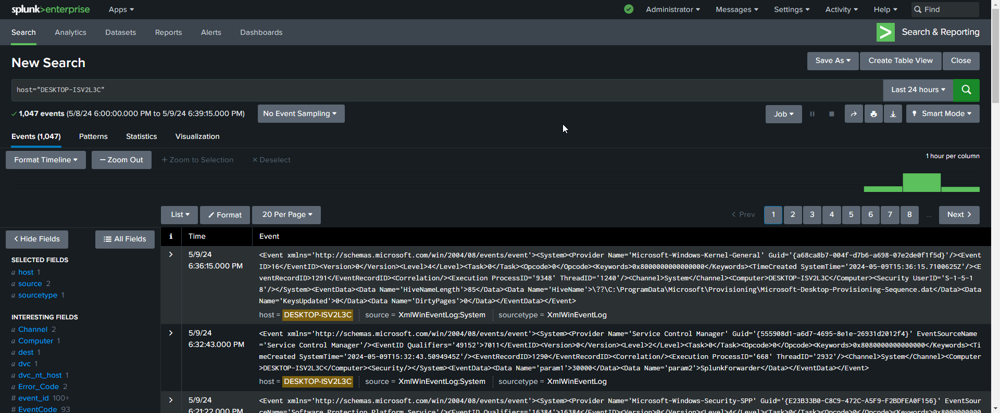

Windows uç noktalarından güvenlik telemetrisi toplamak, SIEM ve tespit mühendisliği çalışmalarının ilk adımıdır. Bu laboratuvar çalışmasında, sanal bir Windows 10 istemcisindeki olay günlüklerini (Application, Security, System) merkezi Splunk Enterprise sunucusuna aktarmak üzere Splunk Universal Forwarder ve `Splunk_TA_windows` (Splunk Add-on for Microsoft Windows) eklentisinin yapılandırma adımlarını ele alıyoruz.

İndirme bağlantıları:
- [Splunk Enterprise 9.2.1](https://www.splunk.com/en_us/download/splunk-enterprise.html)
- [Splunk Universal Forwarder 9.2.1](https://www.splunk.com/en_us/download/universal-forwarder.html)

## 1. Splunk Enterprise Dinleme Portunun Açılması (Port 9997)

Splunk Enterprise üzerinde Forwarder makinelerinden gelecek telemetri akışını karşılamak için varsayılan `9997` TCP portunu dinlemeye açıyoruz:

1. **Settings > Forwarding and receiving** menüsüne gidin.
2. **Receive data > Configure receiving** seçeneğine tıklayın.
3. **New Receiving Port** alanına `9997` girip kaydedin.

<figure>



<figcaption>Şekil 1: Splunk Enterprise üzerinde 9997 portunun dinlemede (Enabled) olduğunu doğrulama.</figcaption>
</figure>

## 2. Splunk Add-on for Microsoft Windows (Splunk_TA_windows)

Windows olay günlüklerinin ham metin olarak kalmaması, CIM (Common Information Model) uyumlu alanlara (`EventCode`, `Process_Name`, `User` vb.) ayrıştırılması ve zenginleştirilmesi için `Splunk_TA_windows` eklentisi kullanılır. Eklenti hem Splunk Enterprise (Search Head/Indexer) hem de Universal Forwarder tarafında konumlandırılır.

1. Splunk Web arayüzünde **Manage Apps > Install app from file** yolunu izleyin.
2. Splunkbase üzerinden indirilen `splunk-add-on-for-microsoft-windows_880.tgz` paketini yükleyin:

<figure>



<figcaption>Şekil 2: Splunk_TA_windows eklenti arşivinin Splunk Web üzerinden yüklenmesi.</figcaption>
</figure>

<figure>



<figcaption>Şekil 3: Splunk_TA_windows eklentisinin başarıyla yüklendiğinin ve etkinleştiğinin (Enabled) doğrulanması.</figcaption>
</figure>

## 3. Windows 10 Uç Noktasına Universal Forwarder Kurulumu

Windows 10 istemcisinde Universal Forwarder MSI paketi çalıştırılır:

1. Kurulum sihirbazında yerel yönetim için bir `admin` kullanıcı hesabı ve parola tanımlanır.
2. **Receiving Indexer** adımında Splunk Enterprise sunucusunun IP adresi (`10.0.2.8`) ve dinleme portu (`9997`) girilir:

<figure>



<figcaption>Şekil 4: Universal Forwarder kurulumunda Receiving Indexer (10.0.2.8:9997) tanımı.</figcaption>
</figure>

## 4. inputs.conf ile Telemetri Kanallarının Yapılandırılması

`Splunk_TA_windows` arşivi uç noktada `C:\Program Files\SplunkUniversalForwarder\etc\apps` dizinine çıkarılır.

Splunk konfigürasyon hiyerarşisinde `default` dizinindeki ayarlar güncellemeler sırasında üzerine yazılabildiğinden, tüm özel yapılandırmalar her zaman `local` dizininde tanımlanmalıdır:

- Şablon kaynak: `C:\Program Files\SplunkUniversalForwarder\etc\apps\Splunk_TA_windows\default\inputs.conf`
- Çalışma hedefi: `C:\Program Files\SplunkUniversalForwarder\etc\apps\Splunk_TA_windows\local\inputs.conf`

`local\inputs.conf` dosyası oluşturularak Application, Security ve System log kanalları için `disabled = 0` tanımlanır:

<figure class="code-file">
<figcaption>C:\Program Files\SplunkUniversalForwarder\etc\apps\Splunk_TA_windows\local\inputs.conf</figcaption>

```ini
[WinEventLog://Application]
checkpointInterval = 5
current_only = 0
disabled = 0
start_from = oldest

[WinEventLog://Security]
checkpointInterval = 5
current_only = 0
disabled = 0
start_from = oldest

[WinEventLog://System]
checkpointInterval = 5
current_only = 0
disabled = 0
start_from = oldest
```

</figure>

Yapılandırmanın devreye girmesi için Windows Hizmetler konsolundan veya PowerShell üzerinden `SplunkForwarder` servisi yeniden başlatılır:

```powershell
Restart-Service SplunkForwarder
```

## 5. Doğrulama ve SPL Sorguları

Splunk Web konsolunda **Search & Reporting** arayüzüne gidilerek Windows 10 ajanından gelen telemetri doğrulanır.

Uç noktadan veri akışını ve sourcetype dağılımını kontrol etmek için:

<figure class="code-file">
<figcaption>Splunk SPL</figcaption>

```spl
index=* host=*
| stats count by host, sourcetype
```

</figure>

<figure>



<figcaption>Şekil 5: Data Summary penceresinde Windows 10 istemcisinden gelen olay sayımı.</figcaption>
</figure>

<figure>



<figcaption>Şekil 6: Search arayüzünde Windows Event Log telemetrisinin başarıyla indekslendiğinin doğrulanması.</figcaption>
</figure>

Yapılandırma sonucunda Windows 10 istemcisinin işletim sistemi ve güvenlik telemetrisi merkezi SIEM ortamına kesintisiz aktarılmaya başlamıştır.
