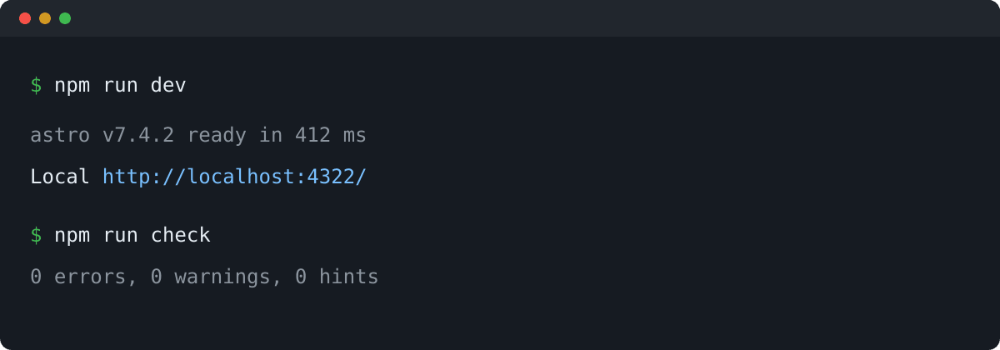

A post is a folder: `src/content/writing/<slug>/index.md`, with its images next to it. The folder name is the URL, so this one lives at `/writing/writing-guide/`. It's a draft, which means it only shows up under `npm run dev`.

Each section shows the Markdown first and the result under it.

## Frontmatter

```yaml
---
title: Writing guide                 # the page's h1
description: One or two sentences.   # lists, RSS, link previews
date: 2026-10-30                     # YYYY-MM-DD
updated: 2026-11-02                  # optional, shown as "updated" in the meta line
tags: [security, home-lab]           # lowercase-kebab-case, each gets /writing/tags/<tag>/
draft: true                          # dev only: no page, feed item, sitemap entry or preview card
pinned: true                         # listed first on the homepage and /writing/
lang: tr                             # en (default) or tr, the language of the body
cover: ./cover.png                   # optional, next to index.md, shown above the body
coverAlt: A full moon over dark hills
---
```

Only `title`, `description` and `date` are required. A tag with capitals or spaces fails the build on purpose, because tags become URLs.

## Headings

The title is already the page's h1, so the body starts at `##`.

```md
## A section
### A part of it
#### A small label
```

`##` and `###` make the outline: a Contents box on narrow screens and a rail of dashes at the right edge on wide ones. It only appears once a post has three of them. `####` and smaller stay out of it.

#### A small label

Every heading gets an id from its text, so this page's "Code blocks" section is `#code-blocks`.

## Text

```md
**Bold**, *italic*, ~~struck out~~ and <mark>highlighted</mark>.
A single line break is just a space.
A `<br>` ends a line early,<br>
like this.
```

**Bold**, *italic*, ~~struck out~~ and <mark>highlighted</mark>.
A single line break is just a space.
A `<br>` ends a line early,<br>
like this.

Punctuation gets smartened outside code: "straight quotes" turn curly and three dots become an ellipsis. Two or three hyphens turn into an en or em dash, so don't type them in prose.

A horizontal rule is three hyphens on their own line, with a blank line above:

```md

---
```

---

## Lists

```md
- Wheat
- Barley
  - Two-row
  - Six-row

1. Plug it in
2. Turn it on
   1. Wait for the light
3. Log in
```

- Wheat
- Barley
  - Two-row
  - Six-row

1. Plug it in
2. Turn it on
   1. Wait for the light
3. Log in

Indent a nested item to line up with the text of its parent: two spaces under `-`, three under `1.`.

## Block quotes

```md
> The quieter you become, the more you are able to hear.
```

> The quieter you become, the more you are able to hear.

## Callouts

Four kinds: `callout-tip`, `callout-info`, `callout-warning` and `callout-danger`. Keep the blank lines around the text, or the Markdown inside won't render.

```md
<blockquote class="callout callout-tip">

The flag is in `/home/rick`.

</blockquote>
```

<blockquote class="callout callout-tip">

The flag is in `/home/rick`.

</blockquote>

<blockquote class="callout callout-info">

SMB shares files and printers over a network.

</blockquote>

<blockquote class="callout callout-warning">

Take a snapshot of the VM first.

</blockquote>

<blockquote class="callout callout-danger">

Never run a sample outside the isolated lab.

</blockquote>

The labels stay in English capitals in a Turkish post too.

## Tables

```md
| Port | Service | Hits |
| :--- | :-----: | ---: |
| 22   | SSH     | 1204 |
| 443  | HTTPS   |   87 |
```

| Port | Service | Hits |
| :--- | :-----: | ---: |
| 22   | SSH     | 1204 |
| 443  | HTTPS   |   87 |

The colons set the alignment. A wide table scrolls sideways instead of breaking the column.

## Links

```md
The [projects](/projects/), a [section of this page](#tables), the [feed](/rss.xml)
and an [outside page](https://docs.astro.build/). A bare URL works too: https://example.com
```

The [projects](/projects/), a [section of this page](#tables), the [feed](/rss.xml)
and an [outside page](https://docs.astro.build/). A bare URL works too: https://example.com

Internal links start with `/` and end with `/`, like `/writing/<slug>/`. A file to download goes in `public/` and is linked from the root: `public/assets/attachment/lab.zip` is `/assets/attachment/lab.zip`. Outside links open in the same tab.

## Code

Inline code is wrapped in backticks: `nmap -sV 10.10.10.5`.

A code block takes a language after the opening fence:

````md
```bash
sudo systemctl restart splunk
```
````

```bash
sudo systemctl restart splunk
```

Any language Shiki knows works (`powershell`, `python`, `yaml`, `json`, `diff`, `sql` and so on). No language means plain text, which suits logs and tool output. Colours follow the day and night theme.

To name the file a block comes from, wrap it in a figure:

````md
<figure class="code-file">
<figcaption>src/site.ts</figcaption>

```ts
const team: Team = 'blue';
```

</figure>
````

<figure class="code-file">
<figcaption>src/site.ts</figcaption>

```ts
const team: Team = 'blue';
```

</figure>

## Images

Put the image next to `index.md` and link it with `./`. The alt text describes it for screen readers and shows if it fails to load.

```md

```


Astro resizes it and turns it into WebP at build time. On a computer, a click opens a larger view, and a click, Esc or a scroll closes it. Phones and touch screens skip that and zoom with a pinch. An image inside a link keeps its link and doesn't zoom. An empty alt (``) marks it as decorative.

A diagram drawn light on a dark background gets `.dark` before the extension. On the day theme it's inverted, so it still reads:

```md

```


The cover is set in the frontmatter (`cover` and `coverAlt`) and sits above the body, like the moon at the top of this page. It zooms too.

## Drawers

For things most readers can skip, like a long run of screenshots:

```md
<details>
<summary>Installer screenshots</summary>


</details>
```

<details>
<summary>Installer screenshots</summary>


</details>

The blank lines inside matter here as well.

## Embeds

An iframe fills the column at 16:9:

```md
<iframe src="https://www.youtube-nocookie.com/embed/VIDEO_ID"
  title="What the video is" allowfullscreen></iframe>
```

## Language

`lang: tr` in the frontmatter marks the whole body as Turkish, so browsers and screen readers read it right. The menus, dates and labels around it stay English. A single phrase in the other language gets a span:

```md
They call it <span lang="tr">korkuluk</span>.
```

They call it <span lang="tr">korkuluk</span>.

## Not supported

These don't render properly today. Each would take a small change first.

- **Task lists** (`- [ ]`): the box shows next to a bullet, unstyled. Needs a CSS rule for `.task-list-item`.
- **Footnotes** (`[^1]`): the notes run on under the last paragraph with no separator, and a hidden "Footnotes" heading lands in the outline. Needs CSS for `.footnotes` and a filter in `PostPage.astro`.
- **Image captions**: a `<figcaption>` under an image comes out indented and unstyled. Needs CSS for `.prose figure`.
- **Raw `` tags**: a relative `src` isn't processed and the image breaks. Use ``.
- **Definition lists** (`Term` then `: definition`): stay plain text. Needs the Markdown processor's `definitionList` option and CSS.
- **Math** (`$...$`): shown as typed. Needs the `math` option plus KaTeX or MathJax.
- **Mermaid**: shown as a code block. Needs a build step that draws it, or export the diagram as `.dark.svg`.
- **Video files**: no styles, and the file has to live in `public/`. Needs CSS for `.prose video`.
- **`:::` blocks, `{#id}` after headings, `^sup^`**: shown as typed. `~sub~` with single tildes turns into strikethrough. HTML `<sup>` and `<sub>` work.
- **Code block extras**: no `title="..."`, line numbers or highlighted lines. Use the figure above for a file name. Needs Shiki transformers.
- **`<kbd>`**: plain monospace with no key look. Needs CSS.
